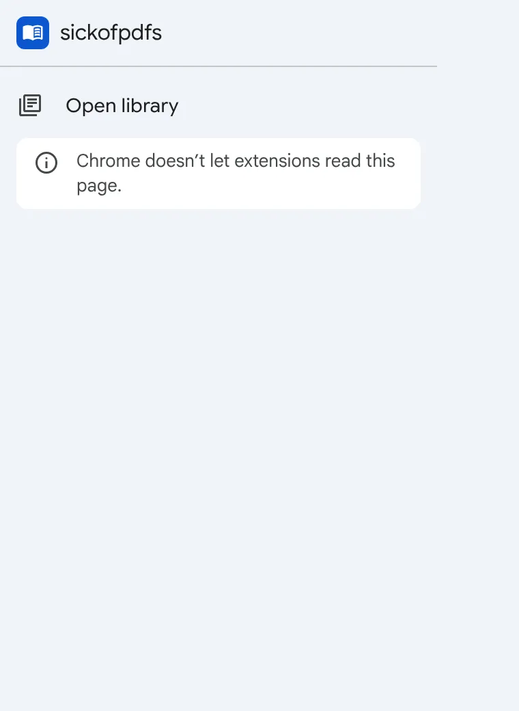
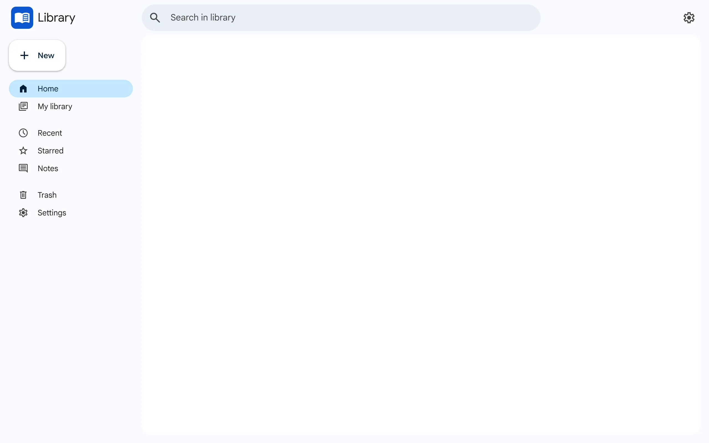
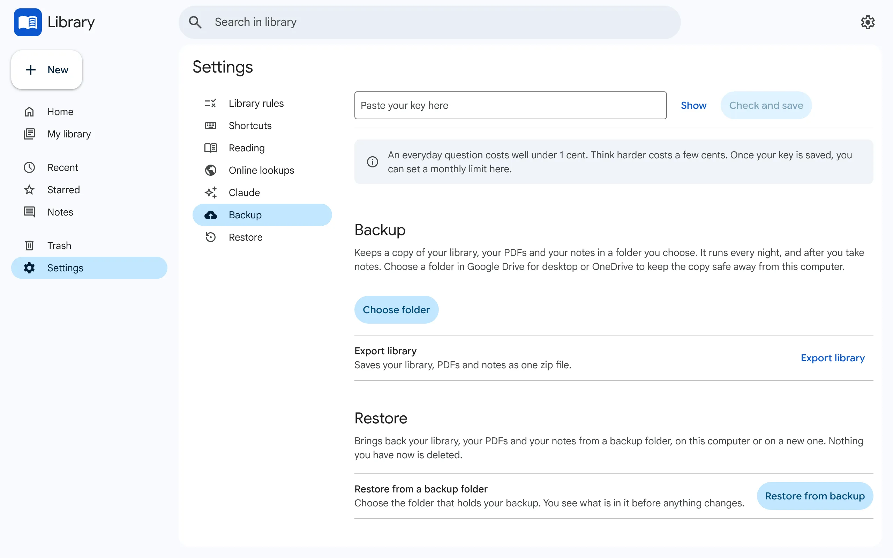
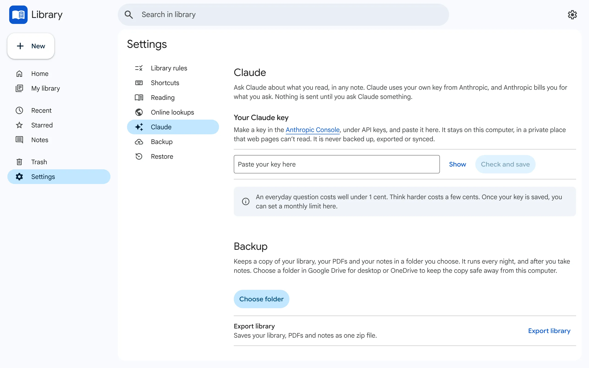

# Set up sickofpdfs (Release 1)

This takes about 10 minutes. You need Windows and Chrome. You do not need any new account. The one extra thing is an Anthropic key, and only if you want @Claude.

Chrome and Windows screens are described in words. The pictures are of our own screens only.

## 1. Download and unzip

1. Open the repo's **Releases** page on GitHub.
2. Under the newest release, click the file ending in **.zip**. It downloads.
3. Make a folder you will keep, for example `Documents\sickofpdfs`.
4. Right-click the zip. Click **Extract All...**. Press **Browse...**, pick your `sickofpdfs` folder, and press **Extract**.
5. Open the folder. You must see **manifest.json** directly inside it, not another folder. If you only see a folder, move everything inside it up one level.

Do not delete or move this folder later. Chrome loads the extension from it.

## 2. Load it into Chrome

1. In Chrome, type `chrome://extensions` in the address bar and press Enter.
2. At the top right, switch **Developer mode** on.
3. Click **Load unpacked** (top left).
4. Choose your `sickofpdfs` folder and press **Select Folder**.
5. Click the puzzle-piece icon in Chrome's toolbar. Click the pin next to **sickofpdfs**.
6. Click the sickofpdfs icon. A small menu opens. Click **Open library**.

You should see the library Home page.

## 3. Allow access to file URLs

This lets sickofpdfs open PDFs that are saved on your computer.

1. On `chrome://extensions`, find the sickofpdfs card. Click **Details**.
2. Scroll down. Switch **Allow access to file URLs** on.
3. Chrome reloads the extension once. That is normal.

## 4. Make Chrome open .pdf files

1. Open Windows **Settings**, then **Apps**, then **Default apps**.
2. In the search box, type `.pdf`.
3. Click the app shown now. Choose **Google Chrome**.
4. Press **Set default** if Windows asks.

Now a double-click on a PDF opens it in Chrome, and sickofpdfs takes it over. If it ever opens somewhere else, the library's **New** button has **Open file**, which always works.

## 5. Pick a backup folder

1. In the library, click **Settings**, then **Backup**.
2. Click **Choose folder**.
3. Pick a folder in **Google Drive for desktop** or **OneDrive**, so the copy lives away from this computer.
4. Chrome asks if the extension may edit files there. Choose the button that allows it.

Your library is copied every night, and after you take notes.

If it ever stops, the toolbar icon shows a red **!**. Click the library's "Backup is waiting" line and allow it again.

## 6. Add your Claude key (optional)

You only need this for @Claude. Anthropic bills you for what you ask. A normal question costs well under 1 cent.

1. Open **console.anthropic.com** and sign in.
2. Set a spend limit first. Go to **Settings**, then **Limits**, and set a **monthly spend limit** you are happy with, for example 5 dollars.
3. Go to **API keys**. Click **Create key**. Name it `sickofpdfs`. Copy the key.
4. In the library, click **Settings**, then **Claude**.
5. Paste the key into the box.
6. Press **Check and save**. It makes three small calls to Anthropic: one to check the key and list the models, then one free count for each of your two models. No document text is sent.
7. You should see that the key is saved.

Your key stays on this computer, in a private place that web pages cannot read. It is never backed up or exported. Settings, Claude has a **Delete key** button.

## How to update

Follow **[apps/extension/HOW-TO-UPDATE.txt](apps/extension/HOW-TO-UPDATE.txt)**. The same file is inside your folder as `HOW-TO-UPDATE.txt`.

The short version: put the new files in the same folder, then press **Reload** on the extension's card.

**Never press Remove.** It deletes your whole library and all your notes.

## What stays private

- Nothing goes over the network unless you turn it on. The two things that can are **Claude** (step 6) and **Online lookups** (Settings).
- Receipts and private documents are never saved. Only PDFs that look like learning are added to your library.
- Your notes live in Chrome, on this computer, and in the backup folder you chose.
