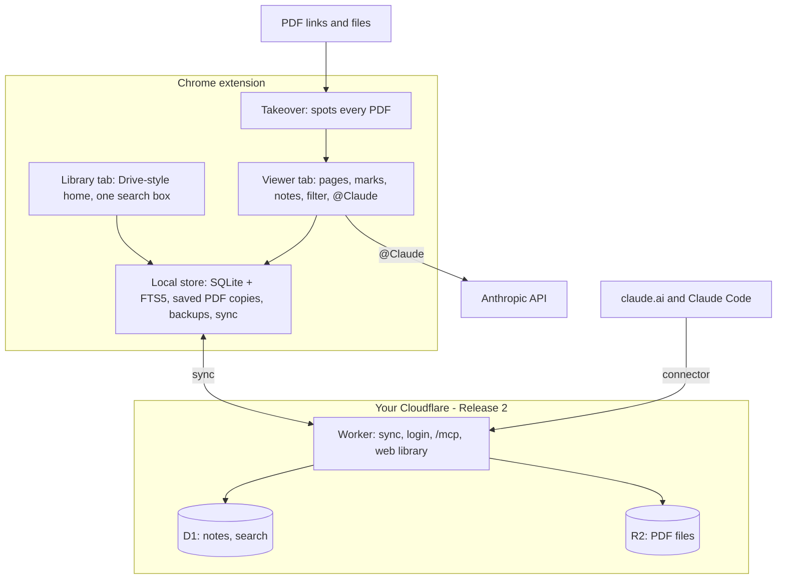

<!-- Canonical, commentable version: https://claude.ai/artifact/X5hCQYmpfh8QM5Zg4A9SEJ . This file is an export for build agents; keep it in sync with the doc. -->

# sickofpdfs — Design Spec v1

Oct 31, 2026 · @rex

## Summary

sickofpdfs is a Chrome extension that replaces Chrome's PDF viewer with a Google-Drive-style reader. You highlight and comment with Ctrl+Alt+M, ask Claude inside comment threads, and every learning PDF you read lands in a searchable library. The library syncs to your own Cloudflare account, so claude.ai can search it too. Commenting is the core feature; everything else supports it.

It ships in three releases, each finished and critic-tested before the next: **Release 1** is the reader, all marks, comments, library and @Claude; **Release 2** adds your cloud and the claude.ai connector; **Release 3** adds text recognition for scans, version linking and Foxit/Acrobat export.

**Release 1 is done when:**

1. Clicking a PDF link, opening a PDF embedded in a page (such as Moodle), or double-clicking a local PDF opens it in our viewer in the same tab. PDFs loaded by a form post, and PDFs with fillable forms, stay in Chrome's viewer. A 50-page paper shows its first page in under 1 second on the reference laptop.
2. Highlight, underline, bold, strikethrough and comment each take one keystroke or one click on a selection. A mark appears in under 50 ms and the note box in under 100 ms.
3. Reopening the same link, or the same file after it is moved, renamed or copied, shows the same notes. A note being typed survives a crash.
4. Learning PDFs are saved automatically. On the research test set and a separate held-out set, zero receipts, invoices or statements are saved.
5. Typing @Claude in a thread returns a streamed answer with clickable page citations.
6. Print, find, zoom, rotate, links, outline, thumbnails and password-protected PDFs work at least as well as in Chrome's viewer.
7. The library and viewer clearly feel like Google Drive, as judged by the visual critic.
8. A full backup (PDFs and notes) is written automatically to a folder you choose.

**Release 2 is done when** everything marked as synced restores after a reinstall (the library shows how many items are still unsynced), the web library works from any computer, and a comment Claude adds in claude.ai appears in the viewer.

**Release 3 is done when** scanned pages can be selected and searched like normal text, notes can be linked across versions of a reading, and an exported PDF shows our marks and threads in Foxit and Acrobat.

Checked by hand: double-clicking in File Explorer, keyboard layouts, the claude.ai connector screens, and Foxit and Acrobat display. Everything else is an automated test.

## Requirements and decisions

Every request so far is mapped to one decision below. Anything not in this table is out of scope.

| You asked for | Decision |
| --- | --- |
| Use it in Chrome, not a separate app | A Chrome extension only. It takes over every PDF automatically, in the same tab. |
| A default PDF reader, including links clicked online | Set Chrome as the Windows .pdf app once. The extension then takes over local files (file://), web links and PDFs embedded in pages (such as Moodle). PDFs loaded by a form post, and PDFs with fillable forms, open in Chrome's own viewer; an "Open in Chrome's viewer" button is always there. |
| Seamless commenting with Ctrl+Alt+M (the core feature) | Select text, press Ctrl+Alt+M, type, press Enter. Notes appear as Google-Docs-style cards in the right margin, with reply threads. Highlight, underline, bold and strikethrough are one keystroke each. |
| Integrated with Claude, like Claude Docs | Two parts: @Claude inside any comment thread (your API key), plus (Release 2) a claude.ai connector that can search your library and add comments. |
| Save PDFs and a history of what you read | Learning PDFs are copied into the library automatically, with reading history, resume position and one search over titles, full text and notes. |
| Only learning PDFs, never receipts | An on-device filter glances at the text in memory and decides before anything is stored. Non-learning PDFs leave no trace. |
| Notes stay on the link and persist | Each PDF is identified by a fingerprint of its contents, and links and file paths are remembered as places it was seen. Notes survive moves, renames and new versions. |
| Hosted | Release 2: your own free Cloudflare account runs sync, backup, a web version of the library, and the Claude connector. |
| Looks like Google Drive (the look and feel) | Drive's Material 3 look and feel: its colours, type, icons, spacing and components. Close in feel, not a pixel-for-pixel copy. |
| Beat Foxit and Google's viewer | Chrome's own PDF engine (PDFium), plus the best ideas from pdf.js, Hypothesis, Zotero, Sioyek and Google Docs. |
| Build on existing repos, no hand-made assets | Reuse open-source code and official icon and font sets (see Licences and credits). |
| Orchestrated build with harsh critics | Build agents write the code. Independent critic agents and automated screenshot checks gate every phase (the gauntlet loop). |
| Any PDF, not just arXiv; scanned PDFs too | Any PDF link or file. Scans open and take page and area notes from Release 1; text recognition (OCR) makes them selectable and searchable in Release 3. |
| Build off Google's PDF reader | PDFium, Google's PDF engine, plus behaviour reused from Chromium's open-source viewer. |
| Highlight, underline, bold, strikethrough and comments, all seamless | A Google-Docs-style toolbar on every selection, one shortcut per mark, no tool modes. |
| Keep it simple first | Three releases, each finished and tested before the next. |

**Not planned:** phone apps, Firefox and Safari, ink drawing, flashcards, sharing with classmates, editing your original files in place, a Ctrl+Alt+M that works inside other apps such as Foxit, and a Chrome Web Store listing (you install it directly first).

## How it feels to use

Ten everyday moments, start to finish. Each becomes an end-to-end test; the two that need Windows File Explorer or claude.ai (2 and 7) are checked by hand.

1. **You click any PDF link.** It could be a journal article, a Moodle reading, lecture slides or a textbook chapter. The tab shows our viewer, not Chrome's. A chip in the top bar reads "Saved to library" (reasons on hover, such as "References section, DOI, 40 pages"). If you have read it before, it opens where you stopped.
2. **You double-click a PDF in File Explorer.** Chrome opens it (it is your default PDF app) and the extension takes over. If that file was seen before, even in another folder or under another name, your notes appear.
3. **You open a scanned PDF.** A photographed chapter or an old journal scan has no real text. From Release 1 you can add page and area notes on it. From Release 3, text recognition runs on your computer, visible pages first, so you can select, mark up and search it like any other PDF.
4. **You mark up and comment.** Select text and a small toolbar appears beside it, as in Google Docs. Highlight (H), underline (Ctrl+U), bold (Ctrl+B), strikethrough (Alt+Shift+5) and comment (Ctrl+Alt+M) apply instantly, with no tool to pick first. For a comment, a note box opens in the right margin, level with the line. Type, then press Enter. Shift+Enter adds a new line, and Esc closes without losing text. With nothing selected, Ctrl+Alt+M makes a note for the page.
5. **You ask Claude.** In a note or reply, type "@Claude why does this assumption matter?" Claude's answer streams into the thread with page links such as "p. 4" that jump to the passage.
6. **You look something up next week.** Press Ctrl+K in any viewer or library tab and type "parallel trends". Results show readings, matching pages and your notes; Enter jumps to the exact passage.
7. **You ask claude.ai (Release 2).** "What did I note about difference-in-differences this term?" The connector searches your library and Claude answers with sources. "Add a comment on page 3 summarising this" appears in the viewer as a comment from Claude.
8. **You move, rename or re-download a file.** Same contents, same fingerprint, same notes. The library records the new location.
9. **Your professor uploads a new version to the same link.** Your notes are copied onto the new version and re-attach by matching the quoted text; the old version keeps its notes. Any that cannot be placed are listed under "Couldn't place" with their quote, never deleted.
10. **You open a receipt.** It displays normally with the chip "Not saved: looks like a receipt". Nothing is stored, indexed or uploaded. If the filter is wrong, one click on the chip saves it.

## Architecture

Two halves: a Chrome extension that does all reading and works offline, and a small server on your Cloudflare account that keeps a synced copy for backup, the web library and Claude.



The viewer is the hub: it reads PDFs, writes to the local store, and calls Claude directly. Only the local store talks to the cloud.

| Piece | Runs in | Job |
| --- | --- | --- |
| Takeover | Extension background (service worker) | Spots PDFs on web pages and local files and sends the tab to our viewer. Logic adapted from Mozilla's pdf.js extension. |
| Viewer | Extension page, one per tab | Draws pages with PDFium, adds the invisible text layer, highlights, margin comment cards and @Claude. |
| Library | Extension page | Google-Drive-style home: Home, Library, Recent, Starred, Courses, Notes, Trash, and search. |
| Local store | Hidden offscreen page plus a worker | The only owner of the local database (SQLite with full-text search); it also runs backups and sync, so they never need an open tab. Tabs write PDF files straight to private file storage and send database changes over a direct message channel. |
| Learning filter | Inside the viewer, in memory | Decides "learning or not" before anything is written anywhere. |
| Sync server | Cloudflare Worker | Release 2: login, sync API, PDF uploads, web library pages. |
| Cloud data | Cloudflare D1 + R2 | D1 holds notes, metadata and page text with search; R2 holds PDF files. |
| Claude connector | Same Worker, at /mcp | Lets claude.ai and Claude Code search, read and comment. |

**Repository layout (one repo, pnpm workspaces):**

```text
apps/extension     Chrome MV3 extension (WXT): background, viewer, library, offscreen store
apps/cloud         Cloudflare Worker: sync API, MCP connector, OAuth, web library
packages/ui        Google Drive design system: tokens, fonts, icons, components
packages/viewer    PdfBackend adapter, PDFium engine, text layer, annotation layer
packages/core      data model, fingerprints, anchoring, learning filter, sync protocol
docs/              this spec, research reports, reference screenshots
```

**Tech stack (versions verified on npm, 31 Oct 2026):**

| Area | Choice |
| --- | --- |
| Extension framework | WXT 0.21.5, Vite 8.3, React 19.3, TypeScript 6 for tooling (TypeScript 7 tried in Phase 0) |
| PDF engine | EmbedPDF @embedpdf/\* 2.15.1 (PDFium compiled to WebAssembly), pinned, small patches. Version 3 if Phase 0 shows it is better. |
| Takeover | Vendored from mozilla/pdf.js extensions/chromium |
| Anchoring | Vendored Hypothesis match-quote plus approx-string-match |
| Local database | @sqlite.org/sqlite-wasm 3.54.1 with FTS5, stored in the origin private file system |
| UI building blocks | Radix UI primitives, Material Symbols Outlined, Google Sans fonts bundled locally |
| Claude | @anthropic-ai/sdk 1.3.0; default model claude-opus-5-5, changeable in Settings |
| Filter tie-breaker | transformers.js with the MiniLM model (23 MB) bundled, no downloads at run time |
| Cloud | Cloudflare Workers, D1, R2, Workers Static Assets, Workers OAuth Provider, MCP server SDK |
| Tests | Vitest, Playwright driving Chromium with the extension loaded, pixelmatch for screenshot diffs |
| Text layer | pdf.js text-layer code (Apache-2.0), fed with PDFium glyph boxes |
| Fingerprints | hash-wasm streaming SHA-256 |
| Text recognition (Release 3) | tesseract.js or a PaddleOCR model on onnxruntime-web, chosen by a bake-off; every file bundled |

## Viewer and commenting

Pages are drawn by PDFium, Google's PDF engine and the one inside Chrome's viewer. An invisible text layer on top makes selecting, double-clicking and copying work like any web page, and marks draw instantly as an overlay.

**Engine.** All engine calls go through one `PdfBackend` adapter: open, render tiles, glyph geometry, search, links, annotations, export. Pages scroll in a virtual list, render in a worker, and re-render sharply at any zoom or Windows scaling. Zoom steps, fit modes and keyboard scrolling follow Chromium's open-source viewer (BSD). Two differences from Chrome remain: a different rasteriser (AGG instead of Skia) and no system fonts, so Latin, Greek and Cyrillic fallback fonts are bundled and non-embedded Chinese, Japanese and Korean text uses one smaller bundled fallback. Every engine file, font and model ships inside the extension; nothing is downloaded. pdf.js stays the fallback engine, with its own export path.

**Text layer.** We port pdf.js's text-layer code (Apache-2.0) and feed it PDFium's glyph boxes and reading order. It must handle two-column papers, rotated tables, ligatures, inline maths and right-to-left text. Phase 0 checks this with a selection test suite, including copy-paste matching Chrome's viewer. Selections map back to PDFium character ranges.

**Keyboard selection.** Ctrl+F finds a phrase and Enter selects the match; Shift+arrow keys then extend it. With the mark shortcuts, nothing needs the mouse.

**Marks.** Select text and a small toolbar appears beside it, as in Google Docs: highlight (with colour), underline, bold, strikethrough, comment, Ask Claude and copy. Each applies instantly from the toolbar or its shortcut, with no tool to pick first.

- One passage can carry several styles at once, such as highlight plus underline.
- Applying a style that already covers the whole selection removes it from that selection, splitting the mark if needed.
- Colours apply to highlight, underline and strikethrough: yellow = key point, blue = definition, green = evidence, pink = question, grey = to do. Keys 1 to 5 recolour; your last colour is remembered.
- Bold redraws the covered text heavier using PDFium's fill-and-stroke text mode, so it stays crisp at any zoom. If Phase 0 shows it looks wrong, bold becomes a "strong" style (dark underline plus heavier highlight), and you are asked first.
- **Area marks:** Alt+drag a rectangle around a figure, an equation image or part of a scan, then comment on it.
- Marks live in our database and draw as an SVG overlay. They are written into a PDF only when you export.

**What a note is made of:**

- **Mark:** style, colour and anchor. A text anchor holds the page boxes it covers (one set per page, so it can span pages), the exact quote, 32 characters before and after, and its character position. An area anchor holds the page and rectangle.
- **Thread:** belongs to one mark, a point on a page, a page, or the whole document. It holds comments, each with author (you or Claude), Markdown body, and created and edited times.
- **Re-anchoring on open:** the stored position is used only if the quote still matches there; next comes the quote on the same page; then a fuzzy match across the document scoring at least 0.8 on a quote of at least 12 characters. Anything else goes to "Couldn't place", never onto doubtful text.

**The Ctrl+Alt+M flow:**

1. With text selected, Ctrl+Alt+M creates a highlight in under 50 ms and opens a note box in the right margin, level with the selection, never covering it.
2. Type plain text or light Markdown (Ctrl+B and Ctrl+I format the note), including maths written as `$x^2$`. The draft saves locally every 300 ms, so a crash loses nothing.
3. Enter or Ctrl+Enter saves; Shift+Enter adds a new line. Esc or clicking away also saves typed text. An empty new note cancels its highlight; emptying an existing note keeps the highlight.
4. No selection: a note at the pointer if it is over a page, otherwise on the most visible page. Ctrl+Alt+Shift+M opens the single "my takeaways" note for the document.
5. A selection over an existing mark opens that mark's thread instead of stacking a duplicate.
6. Cards line up with their marks down the margin, like Google Docs. The active card moves left and its mark darkens.
7. The same document open in two tabs stays in step; a draft belongs to the tab where it was started.

**Reading basics, at least as good as Chrome's viewer (Release 1):**

| Feature | How it works |
| --- | --- |
| Print | Ctrl+P renders pages through PDFium into a print-only copy, with or without your marks |
| Zoom | Fit width, fit page, 25 to 400%; Ctrl+= / Ctrl+− / Ctrl+0, Ctrl+wheel and pinch zoom the page, not the browser |
| Find | Ctrl+F with match count, next and previous |
| Navigate | Thumbnails, outline, go to page, links inside the PDF (contents, citations) and out to the web |
| Rotate and views | Rotate 90°, two-page view, presentation mode for slides, dark (inverted) pages |
| Password PDFs | Asks for the password; the library keeps the encrypted original and asks again next time |
| Forms | PDFs with fillable fields open in Chrome's own viewer, which fills and saves them |
| Escape hatch | File → "Open in Chrome's viewer", always available |
| Save | Ctrl+S downloads the original; File → "Copy link" |
| Large files | Up to 1 GB opens normally; larger files open in Chrome's viewer with a note |
| Accessibility | WCAG 2.2 AA for the interface; the text layer is readable by screen readers |

**Shortcuts.** Single-key and Ctrl+Alt shortcuts never fire while you are typing, because on some keyboards Ctrl+Alt is AltGr. Keys are matched by physical position, so Alt+Shift+5 works on any layout. All are rebindable in Settings, and Ctrl+U only acts when text is selected.

| Action | Keys | When |
| --- | --- | --- |
| Comment on selection, or note at pointer or page | Ctrl+Alt+M | Reading |
| Document note | Ctrl+Alt+Shift+M | Reading |
| Highlight / underline / bold / strikethrough | H / Ctrl+U / Ctrl+B / Alt+Shift+5 | Text selected |
| Area mark | Alt+drag | Reading |
| Save note / new line / close | Enter or Ctrl+Enter / Shift+Enter / Esc | Writing a note |
| Next / previous note | Ctrl+Alt+N / Ctrl+Alt+P | Reading |
| Move between marks | Tab / Shift+Tab | A mark is focused |
| Recolour / delete | 1 to 5 / Delete | A mark is focused |
| Undo / redo | Ctrl+Z / Ctrl+Y | Anywhere |
| Go anywhere: library, notes, commands | Ctrl+K | Anywhere |
| Find / go to page | Ctrl+F / Ctrl+G | Reading |
| Zoom in / out / fit width | Ctrl+= / Ctrl+− / Ctrl+0 | Reading |
| Rotate | Ctrl+\] / Ctrl+\[ | Reading |
| Print / download original | Ctrl+P / Ctrl+S | Reading |
| Notes panel / thumbnails and outline | Shift+F4 / F4 | Reading |
| Save to library | Ctrl+Alt+S | Reading |
| Export notes as Markdown | Ctrl+Shift+E | Reading |
| Shortcut sheet | ? | Reading |

Jumps inside a document (links, search results, next note) are kept in the page's history state and collapsed, so Back returns to where you were without needing many presses to leave.

**Export and import.** Release 1: "Export notes" writes Markdown with quotes, page numbers and links back, and annotations already inside a PDF always display. Release 3: "Download with notes" writes standard PDF annotations (highlights, underlines, strikethroughs, bold marks with their own appearance, comments and reply threads) using PDFium's incremental save. Existing annotations then import as editable notes, de-duplicated by their PDF ids, so re-opening an exported copy never doubles notes. Your original file is never modified.

**Scanned PDFs.** Release 1: scans open normally and take page, point and area notes. Release 3: text recognition (OCR) runs in the hidden background page, so it keeps going after the tab closes, visible pages first, and only for saved PDFs. English comes first, with French and German packs. Results are stored per page with the engine name and version; marks on recognised text anchor to that text, and an engine upgrade re-runs recognition and re-anchors by quote.

**Speed budgets:** first page under 1 s for a 50-page paper; a 600-page scanned textbook scrolls without a blank page showing for more than 150 ms; any mark under 50 ms; note box under 100 ms. They are measured on a fixed reference laptop at each phase gate; CI runs looser smoke versions so random slowness never blocks work.

## Library and knowledge base

A PDF is known by what it contains, not where it lives. Links and file paths are only places it has been seen, so moving or renaming a file never loses notes.

**Identity rules:**

1. **A document is its fingerprint:** the SHA-256 of the file's bytes, computed while it streams in. The same bytes from any link or folder are the same document with the same notes. Every device derives the same id, so sync never creates duplicates.
2. **Same link, new bytes = a new version of the same reading.** This covers a professor updating a file. Your notes are copied onto the new version and re-anchored; the old version keeps its own notes and still opens.
3. **Different link and different bytes = a separate reading.** From Release 3, a new version is linked automatically only when the arXiv id in the link or file name matches, or the DOI in the PDF's own metadata matches. Weaker hints (the PDF's internal ID, similar first pages) only prompt: "Looks like a new version of X. Link notes?"
4. **A reading** is a synced record that groups versions, so every device groups them the same way.

Each document keeps its locations (links and file paths, first and last seen). Learning PDFs are also copied into the library, so a dead link or deleted file still opens.

**What the history records per reading:** title, authors, year, DOI or arXiv id, locations, first and last opened, total reading time, last position (opening resumes there), pages visited, note count and starred. Metadata comes from the PDF itself, its first page and its ids. Optional lookups (arXiv, Crossref) run only for saved PDFs and send only the id.

**One search box (Ctrl+K)** covers titles, authors, full page text, your notes and Claude's replies, ranked by relevance with highlighted snippets. Enter jumps to the exact page and passage. Filters: starred, has notes, date read, and type (paper, book, slides or other, guessed from page count, page shape and headings).

**Library pages, laid out like Google Drive:**

| Page | Shows | Release |
| --- | --- | --- |
| Home | Continue reading and recent notes | 1 |
| My library | Every saved reading, list or grid, sortable like Drive | 1 |
| Recent | Readings by last opened | 1 |
| Starred | Readings you starred | 1 |
| Notes | Every note and thread across all readings, newest first, searchable | 1 |
| Trash | Removed readings and notes, kept 30 days | 1 |
| Settings | Shortcuts, filter rules, Claude key and model, backup folder, cloud | 1 |
| Courses | Groups by course code found in the link, folder or first page (such as EC1A1); rename or merge freely | 3 |

The "+ New" button offers Upload PDF, Open file and Paste link. In an Incognito window the extension only views PDFs and never saves anything.

## Learning filter and privacy

The filter runs on your computer, in memory, before anything is stored. It glances at the text to tell a reading from a receipt, then forgets it unless the PDF is saved.

**Steps (stop at the first that decides):**

1. **Your rules:** a per-file choice, then deny lists, then allow lists for sites and folders (for example, always save from moodle.lse.ac.uk).
2. **Hard block:** a card number (16 digits, valid checksum, known card prefix), or two or more of IBAN, sort code with account number, National Insurance number, passport line or boarding-pass code. This blocks saving unless the academic evidence is overwhelming (a score of 8 or more, such as a paper quoting an example IBAN).
3. **Force save:** an arXiv id plus a References section, or a DOI plus an Abstract plus References.
4. **Score** from cheap signals in under 150 ms: the link, file name, PDF metadata, page count and shape, and text from the first and last 5 pages. 3 or more saves; 0 or less does not; anything between is "not sure".
5. **Not sure:** a small bundled model (MiniLM, about 20 ms) nudges the score. If still unsure, the chip asks you.
6. **Scans with no text:** saved automatically only from scholarly sites or course pages; otherwise the chip asks. They are never OCR'd to decide.

The score starts at −1, so an unknown PDF needs evidence. Rules and weights are ported exactly from the research prototype, whose expected outputs become the test; it scored 43 of 44 with zero false saves.

| Signal | Weight |
| --- | --- |
| arXiv id in text or file name | +4 (file name +3) |
| Scholarly site (arXiv, JSTOR, SSRN, NBER, Springer, ScienceDirect, OpenStax, about 40 more) | +3 |
| References or Bibliography heading | +2.5 |
| Long document: 100+ / 30+ / 8+ pages; 2 or fewer pages | +2.5 / +2 / +1; −1 |
| Abstract heading, DOI, thesis wording | +2 each |
| Moodle, Canvas, reading lists, lecture capture | +2 |
| Many citations (20+ / 5+) | +2.5 / +1.5 |
| Academic vocabulary, maths symbols | up to +2, up to +1.5 |
| Chapter, Lecture, Week or Contents; ISBN; LaTeX-made PDF | +1.5 each |
| University domain (.ac.uk, .edu), slide-deck shape, course words in path | +1 each |
| Each admin term group (invoice, VAT, sort code, payslip, boarding pass…) | −1, up to −5 |
| Lots of currency amounts | up to −3 |
| Bank, shop, airline, tax or e-signature site | −4 |
| Receipt-roll page shape, tax-form type, invoice or receipt in path | −2 each |
| Made by invoice-generator software | −1 |

**What leaves your computer, and when:**

| Data | Goes to | When |
| --- | --- | --- |
| The PDF request itself | The site it came from | Every time you open a PDF, exactly as in Chrome |
| Document text | Anthropic | Only when you ask Claude; on a PDF not in your library, only after you confirm |
| Library data, notes and PDFs | Your Cloudflare | From Release 2, only for saved learning PDFs |
| A DOI or arXiv id | arXiv or Crossref | Only for saved PDFs, and only the id |
| Anything else | Nobody | No code, fonts or models are downloaded; a build test fails on any other request |

**Local traces.** A PDF that isn't saved leaves no history row, thumbnail, search entry or log line. Two exceptions: choosing "Never save this file" keeps a salted fingerprint on this computer only, and Chrome's own history lists the viewer address as it does for any page. Incognito avoids both, and there the extension never saves.

**Notes on a PDF that isn't saved:**

- Your first mark or note on a "not sure" PDF saves it to the library, with an Undo chip.
- Marks on a PDF judged not learning go to a local pending area: kept 7 days, never indexed or synced, and you are offered Save.

**When the filter is wrong:**

- The chip in the top bar always shows the decision; click it, or press Ctrl+Alt+S, to save. Saving back-fills the history.
- "Not sure" PDFs show a quiet banner after 20 seconds: Save, Not now, Never for this file, or Always for this site.
- "Forget this PDF" removes it completely, including from your cloud, with an option to never save it again.
- Settings has the allow and deny lists, pre-filled with suggestions such as moodle.lse.ac.uk.

**Tests.** The research set and a separate held-out set run on every build, and any receipt, invoice or statement saved fails it. Test PDFs are pinned by checksum in a test-assets release, and only openly licensed files are published. A PDF you report as misjudged joins a private test set that stays on your computer.

## Storage, sync and backup

Everything is written locally first, so reading and noting work offline. Release 1 backs up to a folder you choose; Release 2 adds your cloud on top.

**On your computer (inside Chrome):**

- **Database:** SQLite with full-text search, owned by one hidden background page that Chrome recreates on demand. Tables: readings, documents, locations, page text, marks, threads, comments, history, settings, pending notes, and an outbox of changes to sync.
- **PDF copies:** tabs write them straight into the extension's private file storage, named by fingerprint, so duplicates are stored once. Large data never travels through Chrome's extension messages (limited to about 64 MB); it goes through a direct channel or the file storage.
- **Tabs in step:** a broadcast channel tells every open tab when something changes.
- **Safety:** unlimited storage, and a fixed extension key we generate ourselves (no Web Store account needed), so the extension's identity and data survive updates and folder moves.

**Backups (Release 1).** Every night, and after each session with new notes, a backup goes to a folder you pick, such as one inside Google Drive for desktop or OneDrive: PDFs, notes as Markdown, and the data as JSON. If Chrome needs you to reconnect the folder, the extension icon shows a badge. "Export library" saves the same as a zip at any time.

**Sync rules (Release 2):**

- Documents are keyed by fingerprint; other records have random ids.
- Every change carries the revision it was based on and a hybrid clock, not the computer's wall clock, which can be wrong. If two devices changed the same record, the later change wins, and the other version of a note's text is added to its thread as a reply marked "edited on another device".
- An edit beats a delete: if one device deletes a note that another edited, the note comes back.
- Sync and uploads run in the hidden background page, so they never need an open tab. Each PDF uploads once per fingerprint, in 32 MB parts.
- The server counts its daily database writes and slows text indexing near the free limit, so your notes always sync first.
- Note drafts stay local; only saved notes sync.

**Restore.** On a new computer, or after reinstalling, sign in once and the library downloads. The library shows how many items are not yet synced, and the extension icon shows a badge if sync has stopped.

## Claude integration

Claude works in two places: inside comment threads while you read (Release 1), and in claude.ai through a connector that sees your whole library (Release 2).

**1. @Claude in comment threads**

- Start a comment with @Claude, picked from autocomplete, or press Ask Claude in the selection toolbar, which does the same.
- Claude receives the thread, the marked quote and the document text. Documents up to about 100,000 tokens (roughly 150 pages) go in whole; for longer ones, Claude gets the pages around the passage plus the most relevant pages found by local search, up to about 40,000 tokens.
- The answer streams into the thread as a comment from Claude, with page citations such as "p. 4" that jump to the passage.
- On a PDF that isn't in your library, Claude asks before any text is sent.
- Cost on the default model, Claude Opus 5.5: a 30-page paper costs about $0.16 for the first question (the text is cached for an hour), then about 2 to 4 cents per follow-up, including Claude's thinking. An estimate appears before any request over $0.25. Settings can switch to Sonnet 5.5 or Haiku 5.5 to spend less.
- Your API key sits in the extension's private database, which content scripts and web pages cannot read. Calls go straight from the viewer tab to Anthropic.
- The web library shows Claude's replies, but new @Claude requests need the extension, because the key never leaves your computer.

**2. The claude.ai connector (Release 2)**

The Worker serves a connector at /mcp. Add it once in claude.ai under Connectors and sign in; it works on the web, desktop and phone, and in Claude Code. A free claude.ai plan allows one custom connector.

| Tool | What it does |
| --- | --- |
| search\_library | Search titles, full text and notes |
| list\_documents | Browse readings with filters |
| get\_document | A reading's details |
| read\_pages | The text of chosen pages |
| get\_annotations | Marks, notes and threads |
| recent\_activity | What you read and noted recently |
| add\_comment | Add a Claude comment on a quote, page or reading, or reply in a thread |
| update\_comment | Edit one of Claude's own comments |

Claude can add and edit only its own comments. It cannot delete or change your notes, or download PDF files. In claude.ai you can set the two writing tools to "ask first".

## Hosting

Release 2. One Cloudflare Worker on your free account serves the sync API, the Claude connector, login and the web library. It never opens a PDF itself; all PDF work happens in Chrome.

| Part | Choice |
| --- | --- |
| Address | `https://sickofpdfs.<your-subdomain>.workers.dev`, free, chosen once because the connector and the extension are tied to it |
| Routes | `/api/*` sync and uploads, `/mcp` Claude connector, `/oauth/*` login, everything else the web library |
| Database | D1 `sop_meta` for readings, notes and sync state; D1 `sop_text_0`, `sop_text_1`… for page text with full-text search (split because each free database holds 500 MB) |
| PDF files | R2 bucket `sop-blobs`, one file per fingerprint, uploaded in 32 MB parts through the Worker |
| Login | GitHub sign-in, locked to your GitHub account's numeric id; any other account is refused |
| Connector | MCP over Streamable HTTP (`agents` 0.32 `createMcpHandler`, `@modelcontextprotocol/server` 2.4) with OAuth from `@cloudflare/workers-oauth-provider` 1.2.4, using Claude's published client identity |
| Extension sign-in | The same GitHub login in a Chrome pop-up; the token stays in the extension's private database |
| Deploys | Build agents deploy only to a separate staging Worker with its own databases. Your production Worker updates only from tagged releases, after a database snapshot. |

**Web library.** It signs in with the same GitHub login and holds a secure session cookie, with cross-site request checks on every change. It is online-only and shows "Saving…" or "Offline, not saved". PDFs uploaded there run the same filter and text extraction in your browser, and large PDFs load from R2 in ranges.

**What goes to the cloud:** only PDFs marked learning. The server checks the extension's label as a safeguard, not a guarantee. Links are cleaned of tokens and local paths are reduced to file names. PDF upload is on by default, with a global switch and a per-document "keep local" option; without R2 turned on, notes and text still sync.

**Cloud backup:** a nightly snapshot of the database goes to R2 and is kept 30 days. Your local backup folder from Release 1 keeps running as an independent second copy.

**Cost for about 2,000 PDFs (about 10 GB):** free, with three tight spots.

| Free limit | Effect | If exceeded |
| --- | --- | --- |
| R2 storage 10 GB | Roughly the size of the library | $0.015 per GB per month (15 GB is about $0.08) |
| D1 100,000 rows written per day | The first full-text indexing of a big library takes 5 to 8 days | Indexing slows; notes still sync first |
| Worker 10 ms CPU per request | Connector calls estimated at 2 to 3 ms, to be checked on Cloudflare | Workers Paid ($5 a month) lifts all three limits |

Turning on R2 needs a one-time checkout in the Cloudflare dashboard, which may ask for a card even though usage stays free.

## Visual design

The library takes Google Drive's Material 3 look and feel, and the viewer takes the feel of Drive's new PDF viewer (December 2025) with Google Docs comment cards added. The goal is the same aesthetic, not a pixel-for-pixel copy; the measured values are the starting point.

**Source of truth.** The research report holds every measured value, 37 reference screenshots and Drive's own colour tokens copied from its production CSS. Each value is labelled live-measured, Google CSS, or estimated from official images (±2 px).

**Colours (Drive's GM3 palette):**

| Role | Value |
| --- | --- |
| Primary (buttons, links, focus ring) | #0b57d0 |
| App background and top bar | #f8fafd |
| Content card | #ffffff, 16 px corners |
| Search bar | #e9eef6 |
| Menus and grid cards | #f0f4f9 |
| Selected nav item and selected row | #c2e7ff, text #004a77 (nav #001d35) |
| Row hover | #ededed |
| Text / secondary text | #1f1f1f / #444746 |
| Dividers / outlines | #c4c7c5 / #747775 |
| Viewer canvas / toolbar pill | #1b1b1b / #333537 |
| PDF file icon | #fc413d |

**Type and icons.** Google Sans for titles, Google Sans Text (Google Sans at optical size 17) for body text and rows, Google Sans Flex for menus and buttons. Google Sans and Google Sans Flex are open-licensed (OFL), and "Google Sans Text" is simply Google Sans at optical size 17. All are bundled inside the extension, so nothing loads from the internet. Icons are Material Symbols Outlined at weight 400, unfilled, filled when selected. The PDF file icon comes from Material Design Icons (file-pdf-box). Google's logo, Product Sans and Drive's own file icons are not used; our mark, the Material Symbol menu\_book on a coloured tile, sits in the logo slot.

**Screens and their Drive reference:**

| Our screen | Matches | Key measurements |
| --- | --- | --- |
| Library shell | Drive, My Drive | Top bar 64 px; search 48 px tall, round ends; nav 256 px wide with 32 px pill items; "+ New" 56 px tall, 16 px corners |
| Reading list | Drive list view | Rows 48 px with 1 px divider; hover, selected and keyboard-focus states exactly as Drive |
| Grid | Drive grid view | 220 × 220 cards, 12 px corners, first-page thumbnail |
| Home | Drive Home | "Welcome" title, collapsible Continue reading and Recent notes sections |
| Menus and tooltips | Drive menus | Menu items 32 px, 4 px corners; dark tooltip #303030 |
| Viewer | Drive PDF viewer | 64 px header with file name and File, View, Tools, Help menus; 48 px pill toolbar; thumbnail and outline rail; white pages with 16 px gaps |
| Comment cards | Docs margin cards | 282 px wide, 12 px corners, 10 px apart; active card turns white, lifts, and shifts 12 px left |
| Notes panel | Docs comments sidebar | 320 px wide, 16 px corners, All and Mine tabs, thread cards with reply box |

Our additions (Comment, colour, Ask Claude, the library status chip) reuse Drive's own button and chip styles, such as the signed-in viewer's "Comment" text button. The library also follows Windows dark mode using Drive's dark tokens.

**Viewer specifics.** Comment cards on the viewer's dark canvas use Drive's dark-theme surface colours, and the active card turns light. At narrow widths, such as a laptop at 125 to 150% Windows scaling, the thumbnail rail collapses first, then cards fold into the notes panel. The signed-in library references come from official Google images, so they are a guide rather than a measurement.

**Design rules the critics enforce:**

- Colours, fonts, icons and spacing come only from the shared token file, taken from Drive. A lint rule blocks raw values.
- Components follow Drive's patterns: pill navigation, rounded search, 48 px rows, menus, chips, tooltips.
- The visual critic compares our screens with the Drive references side by side and flags anything that looks off-brand or inconsistent. Close in feel is the bar; exact pixels are not required.

## Quality process: the gauntlet loop

No piece of work counts as done until it survives the gauntlet. Builders never grade their own work.

1. **Build.** A build agent writes the tests first, then the code, on its own branch.
2. **Automated gates**, all green: type check, lint (including the design-token rule), unit tests, end-to-end tests in Chromium with the extension loaded, the 44-PDF filter test, speed smoke tests, screenshot checks that catch unintended visual changes, a network test (during the filter run nothing may leave except the PDF itself), and a crash test (kill the tab mid-note; the note must survive).
3. **Critics.** Four critic agents start fresh. They get the spec, the running build and screenshots, but never the builder's reasoning. Every defect must come with evidence and a rating: critical, major or minor.
4. **Fix and repeat.** The builder fixes; every gate and critic runs again.
5. **Pass** = zero critical, zero major, all automated gates green. After three failed rounds the task is re-planned (split smaller or approached differently), not forced through.

| Critic | Checks | Evidence it must give |
| --- | --- | --- |
| Visual | Drive look and feel: colours, fonts, icons, spacing, hover, selected, focus, dark mode | Side-by-side screenshots against the Drive references |
| Experience | Every walkthrough in "How it feels to use", keyboard only; speed budgets; no lost text; AltGr safety | Timed step logs and recordings |
| Code and security | Correctness, data-loss paths, the privacy rule, API key handling, Chrome's no-remote-code rule, licences | File and line for each finding |
| Student | "Would I switch from Foxit and Chrome's viewer?" using real readings end to end | Ranked list of frictions |

**Cheap first, expensive last.** Checks run in three tiers so most problems are caught quickly and cheaply:

1. **Automated tests on every change:** Vitest and Playwright, free and done in seconds.
2. **A quick critic on every fix:** a small, fast model (Claude Haiku, or a Groq-hosted model) reviews the diff and screenshots against the spec.
3. **The four full critics only at phase gates,** on the strongest model.

A fix moves up a tier only after passing the one below.

**At the end of each phase** you get a short demo (screenshots and a screen recording) and the list of what passed.

**Checked by hand:** double-clicking a PDF in File Explorer and keyboard layouts (UK, US, German) on your PC after Phase 1; the claude.ai connector screens in Release 2; Foxit and Acrobat display in Release 3. Speed budgets are measured on a fixed reference laptop at each gate. Build agents never touch your production cloud; they deploy to staging only.

## Build phases

Three releases and nine phases, each closed by a gauntlet gate and a short demo for you. Phase 0 starts as soon as you approve this spec, and each release gets its own implementation plan.

```mermaid
flowchart TB
  subgraph R1[Release 1 · Reader, marks, comments, library, @Claude]
    p0["Phase 0 · Engine proof<br/>PDFium in an extension: speed, selection, bold, big files"] --> g0{"Engine passes<br/>otherwise switch to pdf.js"}
    g0 --> p1["Phase 1 · Foundations<br/>Takeover with embeds, reading basics, local store, identity"] --> g1{"You try it on Windows<br/>checklist incl. keyboard layouts"}
    g1 --> p2["Phase 2 · Marks and comments<br/>Toolbar, all marks, area notes, threads, re-anchoring"] --> g2{"No lost text<br/>marks under 50 ms, crash test passes"}
    g2 --> p3["Phase 3 · Library and filter<br/>Filter, history, Drive-style library, search, backups"] --> g3{"Zero false saves<br/>Drive look signed off by critic"}
    g3 --> p4["Phase 4 · @Claude and Release 1<br/>Claude in threads, polish, setup guide, release on GitHub"] --> g4{"Release 1 criteria met<br/>you sign off"}
  end
  subgraph R2[Release 2 · Your cloud and the claude.ai connector]
    p5["Phase 5 · Cloud sync<br/>Worker, GitHub login, sync, restore, staging and production"] --> g5{"Restore works<br/>after a full reinstall"}
    g5 --> p6["Phase 6 · Web library and connector<br/>Library on the web, MCP tools for claude.ai and Claude Code"] --> g6{"Claude's comment appears<br/>in the viewer after sync"}
  end
  subgraph R3[Release 3 · Scans, versions, Foxit and Acrobat export]
    p7["Phase 7 · Scanned PDFs<br/>Local text recognition, visible pages first, searchable"] --> g7{"Scans select like text<br/>accuracy target met"}
    g7 --> p8["Phase 8 · Versions and export<br/>Version linking, PDF export and import, courses"] --> g8{"Foxit shows our notes<br/>round-trip test passes"}
  end
  g4 --> p5
  g6 --> p7
```



**Phase 0 checks the riskiest unknowns before anything is built on them:** PDFium inside a Chrome extension (workers, bundled files), scrolling a 600-page scan within budget, the selection test suite for the text layer, how bold renders, moving 300 MB files between tabs and the background page, and TypeScript 7 tooling. Release 2 opens with its own short test of the claude.ai sign-in and D1's write counting; Release 3 opens with the text-recognition bake-off and a Foxit/Acrobat round-trip.

**Every feature has a home:** the local store and fingerprint identity are in Phase 1, because comments depend on them. Find, outline, thumbnails, print and password PDFs are also Phase 1. Settings, Markdown export and the backup folder are in Phase 3.

## Risks

The riskiest unknowns are tested first, in Phase 0, before anything is built on top of them.

| Risk | Effect if it happens | How it is handled |
| --- | --- | --- |
| Chrome blocks PDFium's helper workers inside the extension | Viewer cannot render | Phase 0 tests it on day one. Fixes: a patched worker URL, EmbedPDF version 3, or pdf.js (which needs its own export path) |
| Text layer misaligned or in the wrong order | Selecting feels broken | Port pdf.js's text layer; Phase 0 selection test suite |
| Bold looks wrong | Bold unusable | Phase 0 test; "strong" style fallback, only with your OK |
| Slow scrolling on huge scanned textbooks | Reading feels laggy | Phase 0 measures a 600-page scan; tiling and quick previews; pdf.js fallback |
| EmbedPDF is mid-rewrite (v2 to v3) | Upgrades break things | Exact version pins, all calls through the adapter |
| Removing the extension deletes local data | Unbacked-up notes lost | Nightly backup folder (Release 1), cloud plus 30-day snapshots (Release 2), badges when either stops |
| A sync bug copies a loss to the cloud | Notes lost everywhere | Independent local backup folder; build agents use staging only |
| The double-click chain on Windows is untested | Local PDFs open in Chrome's viewer | Your checklist after Phase 1; the library's "Open file" works regardless |
| Some PDFs cannot be re-fetched (form posts, expiring links) | Viewer shows an error | Our error page offers "Import this PDF" and "Open in Chrome's viewer" |
| Filter mistakes on new kinds of PDF | A reading not saved, or a private PDF saved | Asymmetric thresholds, a held-out test set, one-click fixes |
| Ctrl+Alt+M on AltGr keyboards (UK, German, Polish) | Shortcut misfires or never fires | Never fires while typing; physical keys; layout check on your PC; rebindable |
| API key in the browser | Key misuse if the PC is compromised | Extension-private database only, spend limit, one-click delete |
| D1's daily write limit | Indexing stalls | Server-side metering, notes first; Workers Paid if needed |
| Text recognition slow or inaccurate (Release 3) | Some words hard to find | Visible pages first, cached; a bake-off picks the engine; area marks always work |
| Foxit or Acrobat ignore our threads (Release 3) | Export less useful | Round-trip test; fall back to folding replies into the comment text |

## One-time setup for you

Release 1 needs about 10 minutes and no new accounts. Release 2 adds about 40 minutes of account setup, with no developer tools on your PC. A step-by-step guide with screenshots ships in the repo as SETUP.md.

**Release 1 (10 minutes)**

- [ ] Download the latest release zip from the repo's Releases page and unzip it to a folder you will keep, such as Documents\\sickofpdfs.
- [ ] Open chrome://extensions, switch on Developer mode, click Load unpacked, choose that folder, and pin the extension.
- [ ] On the extension's Details page, switch on "Allow access to file URLs". Chrome reloads the extension once.
- [ ] Windows Settings → Apps → Default apps → type .pdf → choose Google Chrome.
- [ ] In the extension's Settings, pick a backup folder.
- [ ] For @Claude: create an API key at console.anthropic.com with a monthly spend limit, and paste it into Settings.

**Release 2 (about 40 minutes)**

- [ ] Cloudflare: you chose the account already connected to this session. Pick its workers.dev subdomain and turn on R2. Nothing is created there without your OK.
- [ ] Create a Cloudflare API token with the bootstrap permissions listed in SETUP.md, and copy your Account ID.
- [ ] GitHub: create an OAuth App with the callback address from SETUP.md.
- [ ] In rexheng/sickofpdfs → Settings → Secrets → Actions, add CLOUDFLARE\_API\_TOKEN, CLOUDFLARE\_ACCOUNT\_ID, GITHUB\_CLIENT\_ID, GITHUB\_CLIENT\_SECRET, ALLOWED\_GITHUB\_ID and SESSION\_SECRET.
- [ ] Run the "Bootstrap cloud" workflow once from the Actions tab. It creates the databases, bucket and Workers. Then swap the token for the narrower deploy token SETUP.md describes.
- [ ] Extension → Settings → Cloud → Connect, and sign in with GitHub.
- [ ] In claude.ai: Settings → Connectors → Add custom connector. Name it "My readings", use the address ending in /mcp, choose "Use Claude's published identity", and sign in with GitHub.

## Licences and credits

Everything reused is under a permissive licence, so the app can be shared later. AGPL projects are studied for ideas only; none of their code is copied.

| Project | Licence | How we use it |
| --- | --- | --- |
| [EmbedPDF](https://github.com/embedpdf/embed-pdf-viewer) (PDFium) | MIT (npm) / Apache-2.0 | Dependency, pinned, small patches; comment sidebar ported to React |
| [pdf.js](https://github.com/mozilla/pdf.js) Chrome extension | Apache-2.0 | PDF takeover logic and text-layer code adapted; fallback engine |
| [Hypothesis client](https://github.com/hypothesis/client) anchoring | BSD-2-Clause | Quote matching copied |
| approx-string-match | MIT | Dependency (fuzzy matching) |
| [SQLite WASM](https://sqlite.org/wasm) | Public domain | Local database and search |
| WXT, React, Radix UI, Vite | MIT | Dependencies |
| transformers.js, MiniLM model | Apache-2.0 | Filter tie-breaker |
| Material Symbols | Apache-2.0 | All icons |
| Material Design Icons (file-pdf-box) | Apache-2.0 | PDF file icon |
| Google Sans, Google Sans Flex | SIL OFL 1.1 | Bundled fonts |
| Anthropic TypeScript SDK | MIT | @Claude calls |
| Cloudflare Workers OAuth Provider, MCP SDK | MIT / Apache-2.0 | Hosting and connector |
| Zotero reader, Readest, Koodo Reader | AGPL-3.0 | Ideas only, no code |
| Chromium PDF viewer | BSD-3-Clause | Zoom, fit and keyboard behaviour reused |
| hash-wasm | MIT | Streaming fingerprints |
| tesseract.js or PaddleOCR with onnxruntime-web | Apache-2.0 / MIT | Text recognition for scans (Release 3) |

Not shipped: Google's logos, Product Sans, Google Symbols and Drive's own file icons, which are Google brand assets. The name "EmbedPDF" is a trademark and is not used for this app.
