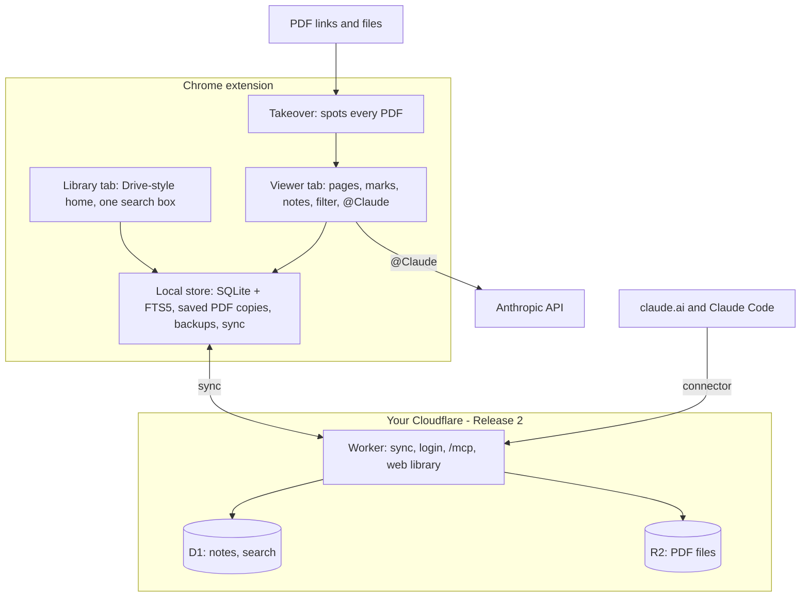

<!-- This repo file is NORMATIVE for build agents. Discussion and comments happen in the Claude Doc (https://claude.ai/artifact/X5hCQYmpfh8QM5Zg4A9SEJ); every doc change is exported here. -->

# sickofpdfs — Design Spec v1

Oct 31, 2026 · @rex

## Summary

sickofpdfs is a Chrome extension that replaces Chrome's PDF viewer with a Google-Drive-style reader. You highlight and comment with Ctrl+Alt+M, ask Claude inside comment threads, and every learning PDF you read lands in a searchable library. The library syncs to your own Cloudflare account, so claude.ai can search it too. Commenting is the core feature; everything else supports it.

It ships in three releases, each finished and critic-tested before the next: **Release 1** is the reader, all marks, comments, library and @Claude; **Release 2** adds your cloud and the claude.ai connector; **Release 3** adds text recognition for scans and Foxit/Acrobat export.

**Release 1 is done when:**

1. Clicking a PDF link, opening a PDF embedded in a page (such as Moodle), or double-clicking a local PDF opens it in our viewer in the same tab. PDFs loaded by a form post, and PDFs with fillable forms, stay in Chrome's viewer. A 50-page paper shows its first page in under 1 second on the reference laptop.
2. Highlight, underline, bold, strikethrough and comment each take one keystroke, or a right-click and one click, on a selection. A mark appears in under 50 ms and the note box in under 100 ms. Clicking a figure selects it, and Ctrl+Alt+M comments on it.
3. Reopening the same link, or the same file after it is moved, renamed or copied, shows the same notes. A note being typed on a saved PDF survives a crash. Re-downloads that differ only by a download stamp keep their notes.
4. Learning PDFs are saved automatically. On the research test set and a separate held-out set, zero non-learning PDFs (receipts, statements, payslips, tax forms, tickets) are saved.
5. Typing @Claude in a thread returns a streamed answer with clickable page citations, plus web sources when it searched. A typical question sends only the relevant passages, not the whole PDF. Asking about a figure sends the figure image with its caption and the text that mentions it.
6. Print, find, zoom, rotate, links, outline, thumbnails and password-protected PDFs work at least as well as in Chrome's viewer.
7. The library and viewer clearly feel like Google Drive, as judged by the visual critic.
8. A full backup (PDFs and notes) is written automatically to a folder you choose while it is connected, and restoring from it on a fresh install brings everything back.

**Release 2 is done when** everything marked as synced restores after a reinstall (the library shows how many items are still unsynced), the web library works from any computer, and a comment Claude adds in claude.ai appears in the viewer.

**Release 3 is done when** scanned pages can be selected and searched like normal text, and an exported PDF shows our marks and threads in Foxit and Acrobat.

Checked by hand: double-clicking in File Explorer, keyboard layouts, the claude.ai connector screens, and Foxit and Acrobat display. The Drive look (criterion 7) is judged by the visual critic. Everything else is an automated test.

## Requirements and decisions

Every request so far is mapped to one decision below. Anything not in this table is out of scope.

| You asked for | Decision |
| --- | --- |
| Use it in Chrome, not a separate app | A Chrome extension only. It takes over every PDF automatically, in the same tab. |
| A default PDF reader, including links clicked online | Set Chrome as the Windows .pdf app once. The extension then takes over local files (file://), web links and PDFs embedded in pages (such as Moodle). PDFs loaded by a form post, and PDFs with fillable forms, open in Chrome's own viewer; an "Open in Chrome's viewer" button is always there. |
| Seamless commenting with Ctrl+Alt+M (the core feature) | Select text, press Ctrl+Alt+M, type, press Enter. Notes appear as Google-Docs-style cards in the right margin, with reply threads. Highlight, underline, bold and strikethrough are one keystroke each. |
| Integrated with Claude, like Claude Docs | Two parts: @Claude inside any comment thread (your API key), plus (Release 2) a claude.ai connector that can search your library and add comments. |
| Save PDFs and a history of what you read | Learning PDFs are copied into the library automatically, with reading history, resume position and one search over titles, full text and notes. |
| Only learning PDFs, never receipts | An on-device filter glances at the text in memory and decides before anything is stored. Non-learning PDFs leave no trace. |
| Notes stay on the link and persist | Each PDF is identified by a fingerprint of its contents, and links and file paths are remembered as places it was seen. Notes survive moves, renames and re-downloads. |
| Hosted | Release 2: your own free Cloudflare account runs sync, backup, a web version of the library, and the Claude connector. |
| Looks like Google Drive (the look and feel) | Drive's Material 3 look and feel: its colours, type, icons, spacing and components. Close in feel, not a pixel-for-pixel copy. |
| Beat Foxit and Google's viewer | Chrome's own PDF engine (PDFium), plus the best ideas from pdf.js, Hypothesis, Zotero, Sioyek and Google Docs. |
| Build on existing repos, no hand-made assets | Reuse open-source code and official icon and font sets (see Licences and credits). |
| Orchestrated build with harsh critics | Build agents write the code. Independent critic agents and automated screenshot checks gate every phase (the gauntlet loop). |
| Any PDF, not just arXiv; scanned PDFs too | Any PDF link or file. Scans open and take page and area notes from Release 1; text recognition (OCR) makes them selectable and searchable in Release 3. |
| Build off Google's PDF reader | PDFium, Google's PDF engine, plus behaviour reused from Chromium's open-source viewer. |
| Highlight, underline, bold, strikethrough and comments, all seamless | Right-click a selection for the mark-up menu, or use one shortcut per mark. Nothing pops up on its own, and there are no tool modes. |
| Keep it simple first | Three releases, each finished and tested before the next. |
| Comment on figures, charts and photos, and ask Claude about them | Figures are found automatically and outlined on hover. Click one to comment or ask Claude; Claude sees the figure image, its caption and the text that cites it. |

## How it feels to use

Ten everyday moments, start to finish. Each becomes an end-to-end test; the two that need Windows File Explorer or claude.ai (2 and 7) are checked by hand.

1. **You click any PDF link.** It could be a journal article, a Moodle reading, lecture slides or a textbook chapter. The tab shows our viewer, not Chrome's. A chip in the top bar reads "Saved to library" (reasons on hover, such as "References section, DOI, 40 pages"). If you have read it before, it opens where you stopped.
2. **You double-click a PDF in File Explorer.** Chrome opens it (it is your default PDF app) and the extension takes over. If that file was seen before, even in another folder or under another name, your notes appear.
3. **You open a scanned PDF.** A photographed chapter or an old journal scan has no real text. From Release 1 you can add page and area notes on it. From Release 3, text recognition runs on your computer, visible pages first, so you can select, mark up and search it like any other PDF.
4. **You mark up and comment.** Select text, then right-click for the mark-up menu, or use a shortcut directly: highlight (H), underline (Ctrl+U), bold (Ctrl+B), strikethrough (Alt+Shift+5) and comment (Ctrl+Alt+M) apply instantly, with no tool to pick first. For a comment, a note box opens in the right margin, level with the line. Type, then press Enter. Shift+Enter adds a new line, and Esc closes without losing text. With nothing selected, Ctrl+Alt+M makes a note where the pointer is, or for the page.
5. **You ask Claude.** In a note or reply, type "@Claude why does this assumption matter?" Claude's answer streams into the thread with page links such as "p. 4" that jump to the passage.
6. **You click a chart.** It gets a blue outline. Right-click it for Comment, Ask Claude, Explain this figure or Copy image. You type "@Claude what does the dip at year −1 mean?" and Claude answers with links to the caption and to the paragraph that discusses it.
7. **You look something up next week.** Press Ctrl+K in any viewer or library tab and type "parallel trends". Results show readings, matching pages and your notes; Enter jumps to the exact passage.
8. **You ask claude.ai (Release 2).** "What did I note about difference-in-differences this term?" The connector searches your library and Claude answers with sources. "Add a comment on page 3 summarising this" appears in the viewer as a comment from Claude.
9. **You move, rename or re-download a file.** Same contents, same fingerprint, same notes. Re-downloads that differ only by a download stamp, as JSTOR adds, are recognised by their text. The library records the new location.
10. **You open a receipt.** It displays normally with the chip "Not saved: looks like a receipt". Nothing is stored, indexed or uploaded. If the filter is wrong, one click on the chip saves it.

## Architecture

Two halves: a Chrome extension that does all reading and works offline, and a small server on your Cloudflare account that keeps a synced copy for backup, the web library and Claude.



The viewer is the hub: it reads PDFs, writes to the local store, and calls Claude directly. Only the local store talks to the cloud.

| Piece | Runs in | Job |
| --- | --- | --- |
| Takeover | Extension background (service worker) | Spots PDFs on web pages and local files and sends the tab to our viewer. Logic adapted from Mozilla's pdf.js extension. |
| Viewer | Extension page, one per tab | Draws pages with PDFium, adds the invisible text layer, highlights, margin comment cards and @Claude. |
| Library | Extension page | Google-Drive-style home: Home, My library, Recent, Starred, Notes, Trash, Settings and search (Courses in Release 3). |
| Local store | Hidden offscreen page plus a worker | The only owner of the local database (SQLite with full-text search); it also runs backups and sync, so they never need an open tab. Tabs write PDF files straight to private file storage and send database changes over a direct message channel. |
| Learning filter | Inside the viewer, in memory | Decides "learning or not" before anything is written anywhere. |
| Sync server | Cloudflare Worker | Release 2: login, sync API, PDF uploads, web library pages. |
| Cloud data | Cloudflare D1 + R2 | D1 holds notes, metadata and page text with search; R2 holds PDF files. |
| Claude connector | Same Worker, at /mcp | Lets claude.ai and Claude Code search, read and comment. |

**Repository layout (one repo, pnpm workspaces):**

```text
apps/extension     Chrome MV3 extension (WXT): background, viewer, library, offscreen store
apps/cloud         Cloudflare Worker: sync API, MCP connector, OAuth, web library
packages/ui        Google Drive design system: tokens, fonts, icons, components
packages/viewer    PdfBackend adapter, PDFium engine, text layer, annotation layer
packages/core      data model, fingerprints, anchoring, learning filter, sync protocol
docs/              this spec, research reports, reference screenshots
```

**Tech stack (versions verified on npm, 31 Oct 2026):**

| Area | Choice |
| --- | --- |
| Extension framework | WXT 0.21.5, Vite 8.3, React 19.3, TypeScript 6 for tooling (TypeScript 7 tried in Phase 0); needs Chrome 128 or newer |
| PDF engine | EmbedPDF @embedpdf/\* 2.15.1 (PDFium compiled to WebAssembly), pinned, small patches. Version 3 if Phase 0 shows it is better. |
| Takeover | Vendored from mozilla/pdf.js extensions/chromium |
| Anchoring | Vendored Hypothesis match-quote plus approx-string-match |
| Local database | @sqlite.org/sqlite-wasm 3.54.1 with FTS5, stored in the origin private file system |
| UI building blocks | Radix UI primitives, Material Symbols Outlined, Google Sans fonts bundled locally |
| Claude | @anthropic-ai/sdk 1.3.0; default model chosen at setup (Haiku 5.5 suggested, Opus 5.5 for Think harder) |
| Filter tie-breaker | onnxruntime-web (one thread, plain wasm; Phase 7 OCR reuses it) with a MiniLM model (about 16 MB) and our own WordPiece tokenizer, all bundled, no downloads at run time. About 0.2 s warm and 1.5 s cold; it runs only for "not sure" PDFs, off the drawing path |
| Cloud | Cloudflare Workers, D1, R2, Workers Static Assets, Workers OAuth Provider, MCP server SDK |
| Tests | Vitest, Playwright driving Chromium with the extension loaded, pixelmatch for screenshot diffs |
| Text layer | pdf.js text-layer code (Apache-2.0), fed with PDFium glyph boxes |
| Fingerprints | hash-wasm streaming SHA-256 |
| Text recognition (Release 3) | tesseract.js or a PaddleOCR model on onnxruntime-web, chosen by a bake-off; every file bundled |
| Figure detection | PDFium page objects and caption rules in Release 1; the PP-DocLayout-S layout model (4.8 MB, Apache-2.0) on onnxruntime-web in Release 3, bundled |

## Viewer and commenting

Pages are drawn by PDFium, Google's PDF engine and the one inside Chrome's viewer. An invisible text layer on top makes selecting, double-clicking and copying work like any web page, and marks draw instantly as an overlay.

**Engine.** All engine calls go through one `PdfBackend` adapter: open, render tiles, glyph geometry, search, links, annotations, export. Pages scroll in a virtual list, render in a worker, and re-render sharply at any zoom or Windows scaling. Zoom steps, fit modes and keyboard scrolling follow Chromium's open-source viewer (BSD). Two differences from Chrome remain: a different rasteriser (AGG instead of Skia) and no system fonts, so Latin, Greek and Cyrillic fallback fonts are bundled and non-embedded Chinese, Japanese and Korean text uses one smaller bundled fallback. The 14 standard PDF fonts (Times, Helvetica, Courier, Symbol, ZapfDingbats, and the Arial, Times New Roman and Courier New names PDFium maps onto them) are never replaced by a bundled fallback: when they are not embedded, PDFium draws them with its own built-in copies, which have the standard widths. Every engine file, font and model ships inside the extension; nothing is downloaded. pdf.js stays the fallback engine, with its own export path; with it, bold uses the "strong" style.

**Text layer.** We port pdf.js's text-layer code (Apache-2.0) and feed it PDFium's glyph boxes and reading order. It must handle two-column papers, rotated tables, ligatures, inline maths and right-to-left text. Phase 0 checks this with a selection test suite, including copy-paste matching Chrome's viewer. Selections map back to PDFium character ranges.

**Marks.** Select text, then right-click: a small menu opens at the pointer with highlight (with colour), underline, bold, strikethrough, comment, Ask Claude, Search and copy. Search opens Google or Google Scholar for the selected words in a new tab; on a reference in a bibliography it finds that paper (Google Scholar, DOI or arXiv). Nothing pops up on its own while you read. Each mark applies instantly from the menu or its shortcut, with no tool to pick first. The keyboard's menu key and Shift+F10 open the menu too, and Shift+right-click shows Chrome's usual menu. A mark action (a colour, highlight, underline, bold or strikethrough) lets go of the selection, so the mark shows in its true colour at once (ruling R71). Right-click on a mark opens its own dark menu: the five colours (keys 1 to 5), comment, and remove (Delete), with the keys shown in the rows; the menu key opens it on a clicked mark (ruling R72). A right-click opens exactly one menu (ruling R80): on an area mark, also one inside a figure, it is that mark menu, with Comment and "Remove area" (an area has no colour slot, so no colour row); on a figure with no area mark under the pointer, it is the figure's menu (Comment, Copy image).&#32;

- One passage can carry several styles at once, such as highlight plus underline.
- Applying a style that already covers the whole selection removes it from that selection, splitting the mark if needed. Comments are separate from styles, so removing or splitting a style never removes a comment.
- Colours apply to highlight, underline and strikethrough:&#32;
- Bold draws the covered glyphs' own outlines (taken from PDFium) again in the overlay, filled and stroked slightly heavier. It works per character, stays crisp at any zoom and must fit the 50 ms budget, which Phase 0 measures. If it looks wrong, bold becomes a "strong" style (dark underline plus heavier highlight), and you are asked first.
- **Figures and areas:** figures, charts, photos, tables and equation images are found on each page. Hovering one gives it a faint outline (nothing pops up); a click selects it, and Ctrl+Alt+M, or right-click → Comment, comments on it. With nothing selected, Ctrl+Alt+M over a figure drops a numbered pin at that spot. Alt+drag (links are ignored while Alt is held), or the area tool in the toolbar, draws any rectangle, such as one panel of a chart or part of a scan. A figure comment shows an outline, not a highlight.
- Marks live in our database and draw as an SVG overlay; printing "with marks" draws the same overlay onto each page. Printing with marks draws marks only (highlights, underlines, bold, strikethrough and area marks, in their own shapes and colours); notes never print, so comments, pins, figure and area note outlines and dotted thread underlines stay off the paper (ruling R78). They are written into a PDF only when you export.

**What a note is made of**

- **Comment thread:** has its own anchor in the same format, or sits on a point, a page or the whole document. Making a comment adds no style and never changes a mark's colour (ruling R68): a commented passage with no style shows a dotted underline, and on marked words the marks stay as they are. A thread holds comments, each with author (you or Claude), Markdown body, and created and edited times.
- **Re-anchoring on open:** the stored position is used only if the quote still matches there; next comes the quote on the same page; then a fuzzy match across the document scoring at least 0.8 on a quote of at least 12 characters. A figure comment stays put while its fingerprint matches; otherwise it follows its caption, then its image. Anything else goes to "Couldn't place", never onto doubtful text.
- **One schema:** the implementation plan defines the single normative data schema. It replaces the research draft, which lacks bold, area marks and separate comment anchors.
- **Figure and area anchor:** the page and a rectangle in page units from 0 to 1. A figure anchor also keeps a fingerprint: its caption label and quote, a hash of the embedded image and a hash of how the region looks. Pins and sub-areas are stored relative to the figure.

**The Ctrl+Alt+M flow:**

1. With text selected, Ctrl+Alt+M creates a comment on the selection, shown on its words in under 50 ms, and opens a note box in the right margin, level with the selection, never covering it.
2. Type plain text or light Markdown (Ctrl+B and Ctrl+I format the note). On a saved PDF the draft saves locally, so a crash loses nothing; on a PDF judged not learning it stays in memory until you choose Save.
3. Shift+Enter adds a new line. Esc or clicking away also saves typed text. An empty new note leaves nothing behind; emptying an existing note never removes a mark.
4. A selection over an existing comment opens that thread (the most recent, if several overlap) instead of stacking a duplicate.
5. Cards line up with their marks down the margin, like Google Docs. The active card moves left and its passage darkens: its highlight takes a darker fill, and words with no highlight get a neutral grey wash, never one of the five colours.
6. The same document open in two tabs stays in step; a draft belongs to the tab where it was started.

**Reading basics, at least as good as Chrome's viewer (Release 1):**

| Feature | How it works |
| --- | --- |
| Print | Ctrl+P renders pages through PDFium into a print-only copy, with or without your marks |
| Zoom | Fit width, fit page, 25 to 400%; Ctrl+= / Ctrl+− / Ctrl+0, Ctrl+wheel and pinch zoom the page, not the browser. A PDF opens at fit width but no larger than 100%, as Chrome's and Drive's viewers do; a narrow window goes below 100% to fit (ruling R61) |
| Find | Ctrl+F with match count, next and previous |
| Navigate | Thumbnails, outline, a Figures tab listing every figure and table, go to page, links inside the PDF (contents, citations) and out to the web |
| Rotate and views | Rotate 90°, two-page view, presentation mode for slides, dark (inverted) pages |
| Bold word starts (R90) | A reading aid: the first part of every word is drawn bold, to guide the eye. One switch in the View menu, remembered across PDFs |
| Password PDFs | Asks for the password; the library keeps the encrypted original and asks again next time; its page text is indexed like any saved PDF unless you switch that off for it |
| Forms | PDFs with real fillable fields (text boxes, choices or checkboxes listed as form fields, or XFA) are classified first and saved if they are learning PDFs, then reopen in Chrome's own viewer to be filled, through a one-time allow rule for that link and tab. Link boxes that LaTeX adds to papers do not count. If the link can't be fetched again, our view stays, with a banner |
| Escape hatch | File → "Open in Chrome's viewer", always available |
| Save | Ctrl+S downloads the original; File → "Copy link" |
| Large files | Up to 1 GB opens normally; larger files (size read from the download header) open in Chrome's viewer with a note. Phase 0 confirms the limit |
| Accessibility | WCAG 2.2 AA for the interface; the text layer is readable by screen readers |
| Embedded PDFs | A PDF shown inside a page (such as Moodle) opens in the full tab, with a "Back to page" button |

**R90: Bold word starts (Nov 2, owner request).** This is a reading aid in the spirit of "bionic" reading. The product never uses the trademarked name "Bionic Reading".
- **What it does.** In every word, the first letters are drawn bold, and the rest stay as printed.
  - Words of 1 to 3 letters get their first letter bold. Longer words get their first half bold, rounded up: "Read·ing" (4 of 7), "met·hod" (3 of 6), "facili·tating" (6 of 12), as in the owner's reference.
  - Only letters count. Pure numbers, maths symbols and punctuation are left alone.
  - Each part of a hyphenated word counts as its own word. A word broken across lines counts per line.
  - An apostrophe does not split a word ("do·n't"). A word that mixes letters and digits is bold from its first character ("2n·d"). Single maths letters set in a text font are bolded like any word.
  - Text that is already bold gets a lighter stroke, so it never smudges. With the switch on, the owner's own bold marks take the same heavier weight.
- **How it is drawn (R90b, Nov 2, owner: "as if it's part of the font").** It is true synthetic bold, as font engines make it, never an outline stroke.
  - Each glyph's outline is pushed outward along its own edges, as in FreeType's `FT_Outline_EmboldenXY`. Upright stems gain about twice what horizontal strokes gain.
  - Corners stay sharp. Counters (the holes in "e", "a" and "o") stay open, so the strength is capped for small or tight glyphs. The x-height and baseline don't move.
  - The amount matches the PDF's own bold where the document has a bold face of the same family. Otherwise it uses a typical regular-to-bold gain.
  - The shapes are filled, never stroked, in the glyph's own colour. They are drawn into a canvas on exactly the page bitmap's device-pixel grid, so each edge is anti-aliased once, like the text.
  - Outlines are cached per page in points, so at any zoom the bold appears in the same frame as the page.
  - The owner's bold marks and print with marks use the same method, so there is one bold look.
  - **R90c (Nov 2, TB5 critics): the bold never closes the gap between letters.**
    - Each glyph grows on each side only as far as leaves at least 1 device px, and at least 45% of the original gap, to its neighbour. So "cl" never reads as "d", and letters never touch.
    - At small sizes on a 1× screen, the gain shrinks so every counter keeps at least 1 device px.
    - The strengths are clearly different steps: on body text at 100% on a 1× screen, Light adds about 15% ink, Medium about 28% and Strong about 42%.
    - Light-coloured text (white on slides) gets bold too.
    - Maths glyphs (maths fonts, single italic maths letters) are left alone.
    - The View menu offers Off, Light, Medium and Strong directly, so the strength can be changed while reading.
  - Selecting, copying, Find, links, marks and comments work exactly as without it.
  - The owner's own bold marks still show whole words bold.
  - It turns with the page (rotation) and works in two-page view and presentation mode.
  - It never prints.
- **Where it can't work.** Pages without real text outlines (scans, and OCR text) are left as they are. The first time such a page is shown with the switch on, a quiet note says: "Bold word starts works on text pages. This page is a scanned image."
- **The switch.**
  - It sits in the View menu as "Bold word starts" (Alt+Shift+S turns it on or off) with Off, Light, Medium and Strong as one radio group.
  - It is listed in the shortcut sheet.
  - It is remembered on this computer for every PDF, and is off until the owner turns it on.
  - Settings → Reading → "How bold" sets the weight (Light, Medium or Strong). The letter rule stays the same; only how heavy the bold is changes. Each strength pairs a growth gain with a little edge darkening that moves no outline: Light 0.9× growth; Medium 1× growth and 0.8 edge darkening; Strong 1.4× growth and 2.2 edge darkening (R90c, measured at +15%, +28% and +42% ink).
- **Speed.** It is drawn for visible pages first, after the page's own render, so it never delays the first paint or scrolling. It is cached per page and zoom. Turning it on shows bold on the visible pages within 300 ms on the reference laptop.

**R93: Caret browsing (Nov 2, owner request).** A text cursor (caret) for reading and selecting by keyboard, like Chrome's caret browsing and Foxit's text cursor.
- **The switch.** View → "Caret browsing", with a check mark and a shortcut. It is remembered on this computer and off at first. F7 is used if Chrome lets the viewer have it; otherwise a key that clashes with nothing.
- **Placing it.** With the switch on, a click in the text puts a thin blinking cursor between letters. With reduced motion, it doesn't blink. A drag still selects as before.
- **Moving.** The cursor follows reading order, so two-column papers go down one column and then the next. The page scrolls to keep it in view.
  - ←/→ move one letter, and Ctrl+←/→ one word.
  - ↑/↓ move one line, keeping roughly the same position across.
  - Home/End go to the start or end of the line, and Ctrl+Home/End to the start or end of the PDF.
  - PageUp/PageDown move one screen.
- **Selecting.** Shift plus any of those keys extends the selection from the cursor. This works with or without the switch: after a mouse selection, Shift+arrows adjust its end.
  - The selection is the same as a mouse selection, so copy, the mark keys, Shift+F10 (the mark menu) and comments all work on it.
  - Esc collapses the selection back to the cursor.
- **Elsewhere.** It works on rotated pages and in two-page view. A Find hit, on Enter, puts the cursor at the hit. Scanned pages without text are skipped, with a quiet note once per tab. A screen reader hears the line the cursor moves to.
- **Without the switch,** the arrow keys scroll as before.

**R98 (Nov 2, TB4 critics): a note never vanishes from view.**
- When the cards fold (no room, the rail open, or slides), each note shows a small numbered marker in the page margin at its anchor, and a click opens it.
- The rail never closes by itself. On slides, the slide refits beside the panel.
- The first-note glide (R79) moves the page no more than needed, and at most 120 px.

**R99: presentation and print keep the reader's place.**
- Esc in presentation mode keeps the slide you are on, and restores zoom and the rail only. This replaces "restores the exact page".
- Ctrl+P's first step asks for the range (All, This page, Pages) as well as marks, and renders only those pages. Enter means the primary choice.

**Shortcuts.** Single-key and Ctrl+Alt shortcuts never fire while you are typing, because on some keyboards Ctrl+Alt is AltGr. Letters and symbols are matched by the character they type, so shortcuts follow your keyboard layout; only the number row (Alt+Shift+5, 1 to 5) is matched by position. Ctrl+= and Ctrl++ both zoom in. All are rebindable in Settings, and Ctrl+U only acts when text is selected.

| Action | Keys | When |
| --- | --- | --- |
| Comment on selection, or note at pointer or page | Ctrl+Alt+M | Reading |
| Document note | Ctrl+Alt+Shift+M | Reading |
| Highlight / underline / bold / strikethrough | H / Ctrl+U / Ctrl+B / Alt+Shift+5 | Text selected |
| Area mark | Alt+drag | Reading |
| Save note / new line / close | Enter or Ctrl+Enter / Shift+Enter / Esc | Writing a note |
| Next / previous note | Ctrl+Alt+N / Ctrl+Alt+P | Reading |
| Move between marks | Tab / Shift+Tab | A mark is focused |
| Recolour / delete | 1 to 5 / Delete | A mark is focused |
| Undo / redo | Ctrl+Z / Ctrl+Y | Reading (the note box keeps its own undo) |
| Go anywhere: library, notes, commands | Ctrl+K | Anywhere |
| Find / go to page | Ctrl+F / Ctrl+G | Reading |
| Zoom in / out / fit width | Ctrl+= / Ctrl+− / Ctrl+0 | Reading |
| Rotate | Ctrl+\] / Ctrl+\[ | Reading |
| Bold word starts | Alt+Shift+S | Reading |
| Print / download original | Ctrl+P / Ctrl+S | Reading |
| Notes panel / thumbnails and outline | Shift+F4 / F4 | Reading |
| Save to library | Ctrl+Alt+S | Reading |
| Export notes as Markdown | Ctrl+Shift+E | Reading |
| Shortcut sheet | ? | Reading |
| Open the mark-up menu | Right-click, menu key or Shift+F10 | Text selected |
| Select a figure | Click | Reading |
| Copy a figure as an image | Ctrl+C | A figure is selected |

Jumps inside a document (links, search results, next note) are kept in the page's history state and collapsed, so Back returns to where you were without needing many presses to leave. A run of jumps (stepping through Find hits, say) is one Back step, even if you scroll by hand between them: Back returns to where the first jump started.

**Export and import.** Release 1: "Export notes" writes Markdown with quotes, page numbers and links back, and annotations already inside a PDF always display. Release 3: "Download with notes" writes standard PDF annotations (highlights, underlines, strikethroughs, bold marks as square annotations with their own appearance, labelled Bold, comments and reply threads) using PDFium's incremental save. Existing annotations then import as editable notes, de-duplicated by their PDF ids, so re-opening an exported copy never doubles notes. Your original file is never modified.

**Scanned PDFs.** Release 1: scans open normally and take page, point and area notes. Release 3: text recognition (OCR) runs in the hidden background page, so it keeps going after the tab closes, visible pages first, and only for saved PDFs. Layout detection runs first, so figures on scans can be clicked too. English comes first, with French and German packs. Results are stored per page with the engine name and version; marks on recognised text anchor to that text, and an engine upgrade re-runs recognition and re-anchors by quote.

**Speed budgets:** first page under 1 s for a 50-page paper; a 600-page scanned textbook scrolls without a blank page showing for more than 150 ms; any mark under 50 ms; note box under 100 ms; figure outline under 100 ms after hovering, and figure detection never delays drawing a page. They are measured on a fixed reference laptop at each phase gate; CI runs looser smoke versions so random slowness never blocks work.

## Library and knowledge base

A PDF is known by what it contains, not where it lives. Links and file paths are only places it has been seen, so moving or renaming a file never loses notes.

**Identity rules:**

1. **A document is its fingerprint:** the SHA-256 of the file's bytes, computed while it streams in. The same bytes from any link or folder are the same document with the same notes.
2. **Same text, new bytes = still the same document.** Many sites stamp each download (JSTOR prints "This content downloaded from \<IP> on \<date>" on every page). If new bytes have the same page count and their page text matches a known document at 99.5% or more after stamp lines, IP addresses and dates are removed, the new fingerprint becomes an alias: same notes, nothing copied.
3. **A genuinely different file is a different document.** PDFs rarely change, so there is no version tracking. If a link ever serves a different file, its notes stay with the old copy, which remains in your library.
4. **Links are canonical:** tracking and token parameters removed, http made https, library-proxy hosts mapped back, and Moodle's revision number removed (in the path, and inside a `file=` value), with the Moodle page that led to the file recorded too. Session keys such as Moodle's `sesskey` are always removed: they never pick a document, and they must not be stored or synced. Local file paths are kept as locations only.
5. **Ids never duplicate across devices.** A document's id is its fingerprint, and a stamped re-download becomes an alias of the first copy seen (if two devices disagree, the smaller id wins). A location's id is a hash of its canonical link, and notes get a random id once, when created.

The exact canonical-link function, the stamp-stripping rules and their test cases are written in the implementation plan.

Each document keeps its locations (links and file paths, first and last seen). Learning PDFs are also copied into the library, so a dead link or deleted file still opens.

**What the history records per reading:** title, authors, year, DOI or arXiv id, locations, first and last opened, total reading time, last position (opening resumes there), pages visited, note count and starred. Metadata comes from the PDF itself, its first page and its ids. Optional lookups (arXiv, Crossref) run only for saved PDFs and send only the id.

**One search box (Ctrl+K)** covers titles, authors, full page text, figure captions, your notes and Claude's replies (including its figure explanations), ranked by relevance with highlighted snippets. Enter jumps to the exact page and passage. Filters: starred, has notes, date read, and type (paper, book, slides or other, guessed from page count, page shape and headings).

**Library pages, laid out like Google Drive:**

| Page | Shows | Release |
| --- | --- | --- |
| Home | Continue reading and recent notes | 1 |
| My library | Every saved reading, list or grid, sortable like Drive | 1 |
| Recent | Readings by last opened | 1 |
| Starred | Readings you starred | 1 |
| Notes | Every note and thread across all readings, newest first, searchable | 1 |
| Trash | Removed readings and notes, kept 30 days | 1 |
| Settings | Shortcuts, filter rules, Claude key and model, backup folder and restore, and cloud (Release 2) | 1 |
| Courses | Groups by course code found in the link, folder or first page (such as EC1A1); rename or merge freely | 3 |

The "+ New" button offers Upload PDF, Open file and Paste link. In an Incognito window the extension only views PDFs: no marks, notes or saving.

**R103: Save a web page as a reading (Nov 6, owner request).** Clicking the extension's toolbar button opens a small Drive-style menu: "Save this page to library" and "Open library".
- "Save this page" reads the article on the current web page, locally (a Readability-style extraction of the title, author, date, text, headings, lists, quotes and images). It works for Medium posts, news articles and blogs.
- It makes a clean, readable PDF on this computer, with:
  - real text and the bundled fonts;
  - the source link and the date saved on the first page;
  - the images, at most 1,600 px wide, converted to JPEG or PNG.
  The PDF is saved as a reading with the page as its source link. Every reading feature then works on it: marks, comments, Bold word starts, caret browsing, search, tags, topics and @Claude.
- Nothing is sent anywhere, and the page is read only on the owner's click. It uses the `activeTab` and `scripting` permissions, so the extension never reads pages on its own.
- The owner's click is the decision, so the learning filter doesn't judge it. The every-page hard-block check (R91) still runs: card, bank or ID numbers make the reading not searchable, with the D9 warning.
- Saving the same page again opens the existing reading. A page that changed since is saved as a new version, linked to the old one. The owner's marks and notes move to the new version, re-anchored on their quotes. A note that can't be placed shows under "Couldn't place" with its quote and is never deleted. The earlier version says "Your notes moved to the newer version".
- If no article can be found (a web app, a login page), the menu says so plainly: "This page doesn't have an article to save."
- On a PDF tab, the menu offers "Open library" only. The viewer already saves PDFs.

**R104: Updating never loses the library (Nov 6, owner request).**
- The extension's ID never changes (the manifest key), so updating by replacing the folder's files and pressing Reload keeps every reading, note, tag and setting. Every test build zip includes a short "How to update without losing your notes" text file.
- Every test build must pass an upgrade check before it ships: install the previous test build, add readings, notes and tags, replace the files with the new build, reload, and check nothing is lost and the database migrated.
- After an update, the library shows "Updated to test build N. Your library is safe." once.
- Removing the extension in Chrome deletes its data; the update text says so plainly, and suggests turning on the backup folder first.

**R92: Tags, the auto categoriser and smart sorting (Nov 2, owner request).** The owner chose two things: auto tags are applied, marked "auto"; and everything runs on the laptop only, with no network.
- **Tags.** Any reading can carry tags.
  - Add or remove them from the library (a row's menu, or several rows at once), from the viewer's "Saved to library" menu, and from File → "About this PDF".
  - The library's left column lists every tag with its count; a click filters the list.
  - Tags can be renamed, merged and deleted.
  - Tags are kept in backups, and sync in Release 2.
- **Auto tags.** They appear straight away as lighter chips marked "auto". One click keeps one (it becomes the owner's own tag) or removes it. A removed auto tag never comes back on that reading. There are three kinds:
  - **Course:** a course code found in the link, the folder or page 1 (such as EC1A1, CS50 or 14.01) becomes "Course: EC1A1". This brings the Courses grouping forward as tags; the Courses page stays in Release 3.
  - **Your tags:** once the owner has given a tag to 3 or more readings, a new reading that is close in meaning to them gets that tag as auto.
  - **Topics:** from 6 readings on, readings that are close in meaning are grouped into topics. Renaming a topic keeps the new name.
    - **Naming (R92b).** A topic takes the name of the closest subject in a bundled list of about 300 academic subjects, drawn from common university course catalogues: "Machine Learning", "Econometrics", "Microeconomics", "Algorithms", "Programming", "Statistics", "Computer Vision" and so on. The match is by meaning, using the same local model, with the list's vectors made at build time.
    - Only if no subject is close enough does a topic take its two most telling phrases, in their natural order ("Monetary Policy · Inflation").
    - Generic words never name a topic: introduction, lecture, notes, chapter, changes, periods, think, and author names.
    - **R92c (Nov 2, TB5 critics): topics come from each reading's own subject.**
      - Each reading takes its own closest subject(s), at most 2, above the threshold. Readings that share a subject form that topic, so names never drift as the library grows: CS231n is Computer Vision, Think Stats is Statistics, XGBoost is Machine Learning.
      - Clustering names only the readings that match no subject.
      - Course codes ignore postcodes and ID numbers ("SE-106 91").
      - The course page the PDF was opened from counts as a course source, on this computer only.
      - After a burst of saves or a restart, topics refresh once the back-fill ends.
      - **Broad fields (R92d).** Every subject belongs to one of about 25 broad fields, such as Economics, Computer Science, Statistics, Mathematics, Physics or Biology. A reading that shares no exact subject joins its broad field's topic when 2 or more readings share it. "No topic" is only for readings that match nothing at all.
  - At most 3 auto topic tags go on one reading.
- **How it works.** The bundled MiniLM model (the filter's tie-breaker) turns each saved reading's title and abstract, or its opening text, into a meaning vector. This happens on this computer, in a worker, after the save and off the reading path.
  - The vectors stay local. They are never backed up or synced, and are rebuilt when needed.
  - Nothing goes over the network. Unsaved PDFs are never categorised.
- **About this PDF.** A details panel, like Drive's file details, opens in the library (from a row) and in the viewer (File → About this PDF). It shows:
  - the title (editable), authors, year, DOI or arXiv id, kind, course and tags;
  - where it came from (the page and link) and when;
  - pages, first and last opened, and reading time;
  - "Your context": a short note on why the owner is reading it. This is the reading's document note.
  The original file is never changed. "Download with notes" (Release 3) writes the tags into the PDF's Keywords and the context into its Subject.
- **Smart sorting.**
  - The library can group by Topic, Course, Tag or Kind; within a group, the most recently opened comes first.
  - "Related readings" lists the 5 closest readings by meaning, in About this PDF and in the library's details panel.
  - Search (Ctrl+K) accepts `tag:` and `course:`.

## Learning filter and privacy

The filter runs on your computer, in memory, before anything is stored. It glances at the text to tell a reading from a receipt, then forgets it unless the PDF is saved.

**Steps (stop at the first that decides):**

1. **Score** from cheap signals in under 150 ms: the link, file name, PDF metadata, page count and shape, and text from the first and last 5 pages. The score starts at −1, so an unknown PDF needs evidence.
2. **Rules, in this order; the first that applies decides:**
   1. Your choice for this exact file.
   2. Hard block: a card number (16 digits, valid checksum, known card prefix), or any two of IBAN, sort code with account number, National Insurance number, US Social Security number, UK tax reference (UTR), passport line or boarding-pass code. Only positive evidence of 8 or more on its own overrides it, such as a paper quoting an example IBAN.
   3. Your deny and allow lists for sites and folders.
   4. Force save: an arXiv id plus a References section, or a DOI plus an Abstract plus References.
   5. The score, for PDFs with text: 3 or more saves; 0 or less does not; anything between is "not sure".
3. **Not sure:** a small bundled model (MiniLM, well under a second) nudges the score. If still unsure, the chip asks you.
4. **Scans with no text** are never saved automatically, and the score is not used for them. From scholarly sites or course pages the chip asks; otherwise they are not saved. They are never OCR'd to decide.
   **R94 (Nov 2, owner): a scan's title counts as a signal.** The title means the file name, the PDF's own title and the link's words.
   - If the title looks like learning, a no-text scan becomes "Not sure" instead of "Not saved". That means a course code (EC1A1, CS50, 14.01), or words such as lecture, chapter, reading, week, notes, slides, textbook, problem set, syllabus, seminar or tutorial. The quiet banner then offers Save, and a first mark asks as for any "not sure" PDF. The chip says "Not sure: scanned pages · Save to library".
   - A title that looks private keeps it "Not saved": receipt, invoice, statement, payslip, bank, tax, CV, résumé, passport, or a camera or scanner name such as IMG_1234 or Scan_2023-01-02.
   - A title never auto-saves a scan, and hard blocks still win.

One reference implementation in TypeScript, with its test cases, defines these rules and weights. It replaces the research prototype, which scored 43 of 44 with zero false saves but had no hard block, force save or MiniLM. Expected results are regenerated from PDFium's text, and any decision that differs from the prototype's is reviewed by hand.

| Signal | Weight |
| --- | --- |
| arXiv id in text or file name | +4 in text, +3 in file name (they add up) |
| Scholarly site (arXiv, JSTOR, SSRN, NBER, Springer, ScienceDirect, OpenStax, about 40 more) | +3 |
| References or Bibliography heading | +2.5 |
| Long document: 100+ / 30+ / 8+ pages; 2 or fewer pages | +2.5 / +2 / +1; −1 |
| Abstract heading, DOI, thesis wording | +2 each |
| Moodle, Canvas, reading lists, lecture capture | +2 |
| Many citations (20+ / 5+) | +2.5 / +1.5 |
| Academic vocabulary, maths symbols | up to +2, up to +1.5 |
| Chapter, Lecture, Week or Contents; ISBN; LaTeX-made PDF | +1.5 each |
| University domain (.ac.uk, .edu), slide-deck shape, course words in path | +1 each |
| Each admin term group (invoice, VAT, sort code, payslip, boarding pass…) | −1, up to −5 |
| Lots of currency amounts | up to −3 |
| Bank, shop, airline, tax or e-signature site | −4 |
| Receipt-roll page shape, tax-form type, invoice or receipt in path | −2 each |
| Made by invoice-generator software | −1 |

**Decided while building the filter (Phase 3, 1 Nov 2026).**
- **Second look for text-poor decks.** If the first and last 5 pages hold fewer than 15 words, up to 10 middle pages are sampled before the no-text rule applies. Slide decks such as the CS50 lectures are judged on their real content. Image-only receipts and scans still never save.
- **CVs never save by score.** CV evidence counts against saving: CV, résumé or curriculum vitae titles, Education, Experience or Skills headings, and a contact block on page 1. A CV laid out like a paper, with a References heading, is personal, not learning.
- **The chip names what a file looks like.** The first reason of a not-learning verdict is a plain "looks like …" phrase for the most specific admin group that matched. For example: "looks like a tax form", "an invoice or receipt", "a bank statement". There are 24 admin groups.
- **Your own choice to save always wins (D9).** This holds even over a card or bank-number block. A warning shows, and the file's text is not indexed.

**What leaves your computer, and when:**

| Data | Goes to | When |
| --- | --- | --- |
| The PDF request itself | The site it came from | Every time you open a PDF, exactly as in Chrome |
| Passages and figure images you ask Claude about (the whole text only if you ask) | Anthropic | Only when you ask Claude; on a PDF not in your library, only after you confirm |
| Words you select and press Search on | Google or Google Scholar, in a new tab | Only when you press Search |
| Claude's web search queries | Anthropic's web search | Only while answering an @Claude question that needs the web; can be switched off |
| Library data, notes and PDFs | Your Cloudflare | From Release 2, only for saved learning PDFs |
| A DOI or arXiv id | arXiv or Crossref | Only for saved PDFs, and only the id |
| Anything else | Nobody | No code, fonts or models are downloaded; a build test fails on any other request |
| Saved PDFs and their notes | Your backup folder, and wherever it syncs (such as Google Drive) | From Release 1; never keys, sign-in tokens or unsaved PDFs |

**Local traces.** A PDF that isn't saved leaves no history row, thumbnail, search entry or log line. Three exceptions: choosing "Never save this file" keeps a salted fingerprint on this computer only; reporting a misjudged PDF keeps your label with a salted fingerprint, never the file; and Chrome's own history lists the viewer address as it does for any page. Incognito avoids the browser-history trace, and there the extension never saves.

**Notes on a PDF that isn't saved:**

- Your first mark or note on a "not sure" PDF saves it to the library.
- Your first mark on a PDF judged not learning asks: "Save this PDF to keep your notes?" Yes saves it. No keeps the notes in memory only, until the tab closes, and nothing is stored.

**The moment a PDF is saved, or un-saved (R67, 1 Nov 2026):**

- **Only real content saves.** Your first mark saves the PDF, or the first letter you type in a new note. Opening a note box saves nothing. Press Esc on an empty note and nothing is saved or stored. If you type a note, delete it again and close it, the save is taken back.
- **Nothing is lost while it saves.** Saving a long book takes a few seconds; the chip says "Saving…". What you mark or type then is kept on this computer at once. If the tab closes or crashes before the save is done, the next time you open the PDF the save finishes and your notes are back.
- **If saving fails**, your notes stay in the tab and on this computer. The chip says "Couldn't save. Try again". Click it to save.
- **Undo is only for a first mark.** A highlight, underline, bold or strike that saved the PDF shows an Undo chip for 10 seconds. Undo removes the save and that one mark. The chip goes as soon as you do anything else to the PDF: another mark, or a note, in any tab.
- **A note that saved the PDF has no Undo.** A note is real work, so a quick Undo never deletes it. You can delete the note itself.
- **Every tab follows an Undo.** Other tabs on the same PDF go back to "Not sure" and drop the undone mark. No tab says "Saved" for a PDF that isn't saved.
- **Undo leaves no trace.** It removes the PDF from the library and everything kept about it on this computer, including unsent notes and the margin hint.
- **Undo never removes another tab's notes (R67 tightened).** If another tab, or another download of the same PDF still being checked, has any note or mark, there is no Undo. A save that carries a note never has an Undo, even after a failed save or when it is finished on reopen.
- **Notes made while the PDF is still being checked are kept at once.** If you close the tab before it knows, they come back next time.
- **On reopen, the chip says "Saving your notes…"** while a save left by a closed tab is finished. Notes kept for a PDF you have not opened for 7 days also show in the library under "Recovered notes", with Copy and Delete. Nothing is deleted without you.

**When the filter is wrong:**

- The chip in the top bar always shows the decision; click it, or press Ctrl+Alt+S, to save. Saving back-fills the history.
- "Not sure" PDFs show a quiet banner after 20 seconds: Save, Not now, Never for this file, or Always for this site.
- **R95 (Nov 2, TB4 critics): the not-sure banner never covers the page.** Its 20-second count pauses during presentation mode (Phase 3 gate). It is an inline bar directly under the toolbar that pushes the pages down, centred on the reading area. Esc means "Not now". In the Tab order it comes right after the chip. Its choices are also in the chip's menu.
- **R96: the save question never eats typing.**
  - Letters typed while it is open go into the note box, in order. Only Enter (Save) or Esc (No) answers it; Space and letters never press a button.
  - Closing a tab whose notes are only in memory brings up the browser's "Leave site?" prompt.
  - A click on a "Not saved" chip asks "This looks like <kind>. Save it to your library anyway?", with Cancel as the default.
  - Report "It's for learning" offers "Save now".
- **R100 (Nov 2, TB5 critics, privacy): Enter never answers the save question.**
  - Letters typed while it is open show in it ("Your note: …") and go into the note.
  - Only a click on a button, or Tab to a button then Enter or Space, answers it. Esc means No.
  - This holds for every PDF, so a quick note on a receipt can never save it.
- **R101: Restore never changes a setting that sends or saves more.** Online lookups and the "Always save from" list are never restored. Restore brings back readings, notes, tags and history, and its summary says "Your settings were not changed".
  - A backup row from this same computer that is newer than the local note keeps both versions, as for another device.
  - A crash-journal draft older than the note's last edit never overwrites it; it shows as a recovered draft instead.
  - Tag names are cleaned on restore (no control or direction characters, at most 60 characters).
  - Course tags of forgotten readings are not restored.
- **R102: private readings stay out of meaning features.** This also covers a reading the owner saved after the filter judged it "not learning" (a receipt, statement, payslip or CV saved on purpose): it stays searchable unless D9 applies, but it never appears in Related readings and never gets topics or auto tags. Restore brings back no settings at all. A reading saved without searchable text (D9) is never in Related readings, in either direction, and never gets topics.
- **R97: "Never save this file" (from the banner, or ticked in Forget) also keeps a salted text fingerprint** (kept in the never-save list, which is read at open); a plain Forget keeps none, because a later open is judged afresh by the filter.
  Originally: (a hash of the normalised text of the first pages), so a re-download with different bytes is still recognised. It is salted like R88/R89 and never kept as the text itself.
- **R91 (Nov 2, from the filter's privacy read): the owner's choices can only make the filter more careful, never less.**
  - **The allow list only turns "not sure" into "save".** It never saves a PDF the filter calls "not learning": no text, a CV, a receipt, a bank statement or a payslip. Hard blocks still beat everything.
  - **"Always for this site" names the place** on its button and in its note, for example "Always for moodle.lse.ac.uk" or "Always for the folder Week 3 readings". It is never offered for catch-all places:
    - local folders: Downloads, Desktop, Documents, the home folder, a drive root, or anything less than two levels below home;
    - mail attachments (Gmail, Outlook);
    - Drive, OneDrive, Dropbox and iCloud downloads;
    - shared object stores (s3.amazonaws.com, storage.googleapis.com, blob.core.windows.net);
    - chat file hosts (Slack, Discord, Teams).
    Typed or synced entries are checked by the same rule. A bare top-level domain, `/`, a drive root or `file:///` is refused.
  - **"Never for this file" holds everywhere at once.**
    - Every open tab re-reads the file choice before a first mark saves.
    - The choice covers the reading's id, every download of it (its aliases) and the opened copy.
    - Only the owner's own explicit Save clears it.
  - **A PDF saved by the owner's click still gets the filter's protections.** A card, bank or ID statement is saved without searchable text, with the warning (D9), however the save starts.
  - **The hard-block check reads every page at save time,** not only the pages the filter sampled. If an automatic save finds card, bank or ID numbers on any page, it stops before anything is written, and the chip says "Not saved: has card or bank numbers". An owner's click saves the PDF without searchable text, with the warning.
  - **Forget always asks,** even with no marks or notes, so "Never save this file" is always offered.
  - **If the owner's choices can't be read,** the PDF is treated as "not learning": nothing saves on its own, and a first mark asks.
  - **Reporting "not for learning" on a saved PDF** says it is still in the library, and offers Forget in the same note.
- "Forget this PDF" removes it completely, including from your cloud, with an option to never save it again.
- Settings has the allow and deny lists, with suggestions such as moodle.lse.ac.uk that you switch on yourself.

**Tests.** Two sets run on every build: the openly licensed research fixtures, committed with a licence list, and a held-out set of at least 20 more public PDFs (10 learning, 10 not) gathered by an agent that never sees the weights and stored in the same test-assets release. Saving any non-learning PDF fails the build; the remaining research fixtures run locally where their licences allow. A PDF you report as misjudged is remembered only as your label and a salted fingerprint, never the file.

## Storage, sync and backup

Everything is written locally first, so reading and noting work offline. Release 1 backs up to a folder you choose; Release 2 adds your cloud on top.

**On your computer (inside Chrome):**

- **Database:** SQLite with full-text search, owned by one hidden background page that Chrome recreates on demand. Tables: documents, locations, page text, marks, threads, comments, history, settings, and an outbox of changes to sync.
- **PDF copies:** tabs write them straight into the extension's private file storage, named by fingerprint, so duplicates are stored once. Large data never travels through Chrome's extension messages (limited to about 64 MB); it goes through a direct channel or the file storage.
- **Tabs in step:** a broadcast channel tells every open tab when something changes.
- **Safety:** unlimited storage, and a fixed extension key we generate ourselves (no Web Store account needed), so the extension's identity and data survive updates and folder moves.
- **After a crash (R65):** If Chrome's extension process crashes, every PDF tab closes at once and Chrome offers to reload sickofpdfs; one click brings it back, every PDF tab reopens at its page, and any unsent note is restored.

**Backups (Release 1).** Every night, and after each session with new notes, a backup goes to a folder you pick, such as one inside Google Drive for desktop or OneDrive: saved PDFs, notes as Markdown, and the library data as JSON. It never includes your API key, sign-in tokens, the never-save list or anything from unsaved PDFs; secrets live in a separate store that backups, export and sync cannot read, and a test checks every backup for the key. Chrome may ask you to re-allow the folder after a restart; Phase 0 tests this, and the extension icon shows a badge whenever a backup is waiting for your click. "Restore from backup" in Settings rebuilds the library on a fresh install, merging by fingerprint and id. "Export library" saves the same as a zip at any time. Backup details (R82–R86, Nov 1):
- **R82: gone for good means gone from backups.** A reading that leaves the library for good (Forget, a Trash purge after 30 days, or an Undo of its save) joins a scrub list. Every backup run removes the listed readings from all 7 snapshots before it does anything else. Trash alone does not scrub; it can still be restored.
- **R83: "after a session with new notes"** means one quiet minute after the last change, and at most one run every 10 minutes.
- **R84: snapshots are named by local date.** Seven snapshots are kept: one per local day, the newest of each day.
- **R85: Settings → Backup** shows the folder, the last good backup time and "Back up now". When Chrome needs the folder re-allowed, it shows "Allow", and one click allows the folder and finishes the waiting backup.
- **R86: a run holds rather than harms.** The run changes nothing if any of these is true:
  - the folder holds another library's readings;
  - its `library.json` cannot be read;
  - many readings, or every reading, vanished since the last good run;
  - the note count dropped by at least 20 and by at least half.

  Readings removed on purpose (Forget, purge, Undo of a save) never count as vanished.
- **R87 (Nov 2): no backup run ever deletes a reading's files unless the reading was removed on purpose.**
  - "Back up anyway" backs up what the library has now. It keeps the folder's copies of any reading that is missing without having been removed on purpose.
  - The hold card says: "Some readings are missing from your library, but your backup still has them. To get them back, use Restore from backup. Back up anyway keeps their copies in the folder." "Not now" is the main button.
- **R88: only Forget and the 30-day Trash purge write the salted forgotten list.**
  - Restore leaves out what is on that list and says how many it left out.
  - An Undo of a save never writes that list. If a backup may already hold the reading, Undo queues a removal from the folder, and the queued id is dropped once the removal is done (R67 "Undo leaves no trace" holds once the queue drains).
  - A queued removal for a folder that no longer exists is dropped, and Settings says so plainly. Raw ids in the queue expire after 30 days. Settings and the badge then say why, with "Back up anyway".

**Sync rules (Release 2):**

- Documents are keyed by fingerprint, stamped re-downloads as aliases of the first copy seen, and locations by their canonical link, so two devices never create duplicates. Notes get a random id once and are never copied.
- Every change carries the revision it was based on and a hybrid clock, not the computer's wall clock, which can be wrong. If two devices changed the same record, the later change wins, and the other version of a note's text is added to its thread as a reply marked "edited on another device".
- An edit beats a delete: if one device deletes a note that another edited, the note comes back.
- Sync and uploads run in the hidden background page, so they never need an open tab. Each PDF uploads once per fingerprint, in 32 MB parts.
- The server counts its daily database writes and slows text indexing near the free limit, so your notes always sync first.
- Note drafts stay local; only saved notes sync.

**Restore.** On a new computer, or after reinstalling, sign in once and the library downloads. The library shows how many items are not yet synced, and the extension icon shows a badge if sync has stopped.

## Claude integration

Claude works in two places: inside comment threads while you read (Release 1), and in claude.ai through a connector that sees your whole library (Release 2).

**1. @Claude in comment threads**

- Start a comment with @Claude, picked from autocomplete, or choose Ask Claude from the right-click menu, which does the same.
- **Claude reads only what it needs.** A question sends the marked passage and its paragraph, a short map of the document (title, abstract, headings) and the five passages local search ranks most relevant: usually 2,000 to 5,000 tokens, not the whole PDF. If that isn't enough, Claude can ask the viewer for specific pages or run another search inside the document, and only those pages are sent. "Ask about the whole document" (for summaries) sends everything, with a cost estimate first.
- Figures. On a figure, area or scanned page, Claude gets the region as an image rendered on your computer, sized so small text stays legible (usually 1,000 to 1,600 image tokens, sharper on Think harder). It also gets the caption, the exact text inside the figure (axis labels, legend), up to three paragraphs that mention it, and the document map with its list of figures. "Compare Figure 2 and 3" attaches both. Claude can't cite an image, so the answer carries a link to the figure. Explain this figure, in the right-click menu, asks a fixed question about it.
- **Claude can search the web** when a question needs outside knowledge, such as a definition, background or newer work. Answers cite web sources next to page citations. At most 1 search per question (owner, 1 Nov 2026), about 1 cent; switch it off in Settings.
- The answer streams into the thread as a comment from Claude, with page citations such as "p. 4" that jump to the passage.
- On a PDF that isn't in your library, Claude asks before any text is sent.
- **Model and cost.** You choose the default model at setup. Recommended: Claude Haiku 5.5 for everyday questions (well under 1 cent each), with a "Think harder" button that re-asks with Claude Opus 5.5 (about 3 to 4 cents). Sonnet 5.5 sits in between. A figure question costs about 0.1 cent on Haiku 5.5 and about 5 cents on Opus 5.5. The document map and the thread are cached, so follow-ups cost less. An estimate appears before any request over $0.25, and Settings has a monthly cap.
- **Free with your Claude plan (Release 2).** "Answer with my Claude plan" opens claude.ai with the question ready; Claude reads the thread through the connector and posts its reply into your PDF, using your subscription instead of the API key.
- Your API key sits in the extension's private database, which content scripts and web pages cannot read. Calls go straight from the viewer tab to Anthropic.
- The web library shows Claude's replies, but new @Claude requests need the extension, because the key never leaves your computer.

**2. The claude.ai connector (Release 2)**

The Worker serves a connector at /mcp. Add it once in claude.ai under Connectors and sign in; it works on the web, desktop and phone, and in Claude Code. A free claude.ai plan allows one custom connector.

| Tool | What it does |
| --- | --- |
| search\_library | Search titles, full text and notes |
| list\_documents | Browse readings with filters |
| get\_document | A reading's details |
| read\_pages | The text of chosen pages |
| get\_annotations | Marks, notes and threads |
| recent\_activity | What you read and noted recently |
| add\_comment | Add a Claude comment on a quote, page or reading, or reply in a thread |
| update\_comment | Edit one of Claude's own comments |

Claude can add and edit only its own comments. It cannot delete or change your notes, or download PDF files. In claude.ai you can set the two writing tools to "ask first".

## Hosting

Release 2. One Cloudflare Worker on your free account serves the sync API, the Claude connector, login and the web library. It never opens a PDF itself; all PDF work happens in Chrome.

| Part | Choice |
| --- | --- |
| Address | `https://sickofpdfs.<your-subdomain>.workers.dev`, free, chosen once because the connector and the extension are tied to it |
| Routes | `/api/*` sync and uploads, `/mcp` Claude connector, `/oauth/*` login, everything else the web library |
| Database | D1 `sop_meta` for readings, notes and sync state; D1 `sop_text_0`, `sop_text_1`… for page text with full-text search (split because each free database holds 500 MB) |
| PDF files | R2 bucket `sop-blobs`, one file per fingerprint, uploaded in 32 MB parts through the Worker |
| Login | GitHub sign-in, locked to your GitHub account's numeric id; any other account is refused |
| Connector | MCP over Streamable HTTP (`agents` 0.32 `createMcpHandler`, `@modelcontextprotocol/server` 2.4) with OAuth from `@cloudflare/workers-oauth-provider` 1.2.4, using Claude's published client identity |
| Extension sign-in | The same GitHub login in a Chrome pop-up; the token stays in the extension's private database |
| Deploys | Build agents deploy only to a separate staging Worker with its own small databases and its own GitHub OAuth app. Your production Worker updates only from tagged releases, after a restore point is recorded. Cloudflare's free limits are shared across the account, so staging has a hard budget of 10,000 database writes a day and production's meter assumes 75,000. Databases: production uses 1 plus up to 4 text shards and staging 1 plus 1, within the free limit of 10. |

**Web library.** It signs in with the same GitHub login and holds a secure session cookie, with cross-site request checks on every change. It is online-only and shows "Saving…" or "Offline, not saved". PDFs uploaded there run the same filter and text extraction in your browser, and large PDFs download from R2 with a progress bar.

**What goes to the cloud:** only PDFs marked learning. The server checks the extension's label as a safeguard, not a guarantee. Links are stored in the same canonical form used for identity, which already removes tokens, and local paths are reduced to file names. PDF upload is on by default, with a global switch and a per-document "keep local" option; without R2 turned on, notes and text still sync.

**Cloud backup:** a nightly GitHub Actions job pages through an authenticated export endpoint, skips the search tables (they can be rebuilt), and writes JSON to R2, kept 30 days. Before every production database change, a D1 Time Travel restore point is recorded (kept 7 days on the free plan). Your local backup folder keeps running as an independent second copy.

**Cost for about 2,000 PDFs (about 10 GB):** free, with three tight spots.

| Free limit | Effect | If exceeded |
| --- | --- | --- |
| R2 storage 10 GB | Roughly the size of the library | $0.015 per GB per month (15 GB is about $0.08) |
| D1 100,000 rows written per day | The first full-text indexing of a big library takes 5 to 8 days | Indexing slows; notes still sync first |
| Worker 10 ms CPU per request | Connector calls estimated at 2 to 3 ms, to be checked on Cloudflare | Workers Paid ($5 a month) lifts the D1 and CPU limits; R2 storage is billed separately |

Turning on R2 needs a one-time checkout in the Cloudflare dashboard, which may ask for a card even though usage stays free.

## Visual design

The library takes Google Drive's Material 3 look and feel, and the viewer takes the feel of Drive's new PDF viewer (December 2025) with Google Docs comment cards added. The goal is the same aesthetic, not a pixel-for-pixel copy; the measured values are the starting point.

**Source of truth.** The research report holds every measured value, 37 reference screenshots and Drive's own colour tokens copied from its production CSS. Each value is labelled live-measured, Google CSS, or estimated from official images (±2 px).

**Colours (Drive's GM3 palette):**

| Role | Value |
| --- | --- |
| Primary (buttons, links, focus ring) | #0b57d0 |
| App background and top bar | #f8fafd |
| Content card | #ffffff, 16 px corners |
| Search bar | #e9eef6 |
| Menus and grid cards | #f0f4f9 |
| Selected nav item and selected row | #c2e7ff, text #004a77 (nav #001d35) |
| Row hover | #ededed |
| Text / secondary text | #1f1f1f / #444746 |
| Dividers / outlines | #c4c7c5 / #747775 |
| Viewer canvas / toolbar pill | #1b1b1b / #333537 |
| PDF file icon | #fc413d |

**Type and icons.** Google Sans for titles, Google Sans Text (Google Sans at optical size 17) for body text and rows, Google Sans Flex for menus and buttons. Google Sans and Google Sans Flex are open-licensed (OFL), and "Google Sans Text" is simply Google Sans at optical size 17. All are bundled inside the extension, so nothing loads from the internet. Icons are Material Symbols Outlined at weight 400, unfilled, filled when selected. The PDF file icon comes from Material Design Icons (file-pdf-box). Google's logo, Product Sans and Drive's own file icons are not used; our mark, the Material Symbol menu\_book on a coloured tile, sits in the logo slot.

**Screens and their Drive reference:**

| Our screen | Matches | Key measurements |
| --- | --- | --- |
| Library shell | Drive, My Drive | Top bar 64 px; search 48 px tall, round ends; nav 256 px wide with 32 px pill items; "+ New" 56 px tall, 16 px corners |
| Reading list | Drive list view | Rows 48 px with 1 px divider; hover, selected and keyboard-focus states exactly as Drive |
| Grid | Drive grid view | 220 × 220 cards, 12 px corners, first-page thumbnail |
| Home | Drive Home | "Welcome" title, collapsible Continue reading and Recent notes sections |
| Menus and tooltips | Drive menus | Menu items 32 px, 4 px corners; dark tooltip #303030 |
| Viewer | Drive PDF viewer | 64 px header with file name and File, View, Tools, Help menus; 48 px pill toolbar; thumbnail and outline rail; white pages with 16 px gaps |
| Comment cards | Docs margin cards | 282 px wide, 12 px corners, 10 px apart; active card turns white, lifts, and shifts 12 px left |
| Notes panel | Docs comments sidebar | 320 px wide, 16 px corners, All and Mine tabs, thread cards with reply box |

Our additions (Comment, colour, Ask Claude, the library status chip) reuse Drive's own button, menu and chip styles (the right-click menu matches Drive's file menu), such as the signed-in viewer's "Comment" text button. The library also follows Windows dark mode using Drive's dark tokens.

**Viewer specifics.** Comment cards on the viewer's dark canvas use Drive's dark-theme surface colours, and the active card turns light. At narrow widths, such as a laptop at 125 to 150% Windows scaling, the thumbnail rail collapses first, then cards fold into the notes panel. The signed-in library references come from official Google images, so they are a guide rather than a measurement.

**Design rules the critics enforce:**

- Colours, fonts, icons and spacing come only from the shared token file, taken from Drive. A lint rule blocks raw values.
- Components follow Drive's patterns: pill navigation, rounded search, 48 px rows, menus, chips, tooltips.
- The visual critic compares our screens with the Drive references side by side and flags anything that looks off-brand or inconsistent. Close in feel is the bar; exact pixels are not required.

## Quality process: the gauntlet loop

No piece of work counts as done until it survives the gauntlet. Builders never grade their own work.

1. **Build.** A build agent writes the tests first, then the code, on its own branch.
2. **Automated gates** for that phase, all green, for example: type check, lint (including the design-token rule), unit tests, end-to-end tests in Chromium with the extension loaded, the filter test sets (from Phase 3), speed smoke tests, screenshot checks that catch unintended visual changes, a network test (during every end-to-end run nothing may leave except the PDF itself and allowed calls), and a crash test (kill the tab mid-note; the note must survive).
3. **Critics.** Four critic agents start fresh. They get the spec, the running build and screenshots, but never the builder's reasoning. Every defect must come with evidence and a rating: critical, major or minor.
4. **Fix and repeat.** The builder fixes; every gate and critic runs again.
5. **Pass** = zero critical, zero major, all automated gates green. After three failed rounds the task is re-planned (split smaller or approached differently), not forced through.

| Critic | Checks | Evidence it must give |
| --- | --- | --- |
| Visual | Drive look and feel: colours, fonts, icons, spacing, hover, selected, focus, dark mode | Side-by-side screenshots against the Drive references |
| Experience | Every walkthrough in "How it feels to use", keyboard only; speed budgets; no lost text; AltGr safety | Timed step logs and recordings |
| Code and security | Correctness, data-loss paths, the privacy rule, API key handling, Chrome's no-remote-code rule, licences | File and line for each finding |
| Student | "Would I switch from Foxit and Chrome's viewer?" using real readings end to end | Ranked list of frictions |

**Cheap first, expensive last.** Checks run in three tiers so most problems are caught quickly and cheaply:

1. **Automated tests on every change:** Vitest and Playwright, free and done in seconds.
2. **A quick critic on every fix:** a small, fast model (Claude Haiku, or a Groq-hosted model) reviews the diff and screenshots against the spec.
3. **The four full critics only at phase gates,** on the strongest model.

A fix moves up a tier only after passing the one below.

**At the end of each phase** you get a short demo (screenshots and a screen recording) and the list of what passed.

**Checked by hand:** double-clicking a PDF in File Explorer on your PC after Phase 1; keyboard layouts (UK, US, German, Polish) after Phase 2 and again at Phase 4; the claude.ai connector screens in Release 2; Foxit and Acrobat display in Release 3.

**Gates per phase.** Each phase has its own gate list in the implementation plan, because some tests (such as the filter test) only exist from a later phase. Speed budgets are measured on the reference laptop: a pinned Windows test machine running stable Chrome at 150% scaling, with 20% tolerance. @Claude is tested against recorded replies in CI and against the real API once per phase gate. Build agents never touch your production cloud; they deploy to staging only.

## Build phases

Three releases and nine phases, each closed by a gauntlet gate and a short demo for you. Phase 0 starts as soon as you approve this spec, and each release gets its own implementation plan.

```mermaid
flowchart TB
  subgraph R1[Release 1 · Reader, marks, comments, library, @Claude]
    p0["Phase 0 · Engine proof<br/>PDFium in an extension: speed, selection, bold, big files"] --> g0{"Engine passes<br/>otherwise switch to pdf.js"}
    g0 --> p1["Phase 1 · Foundations<br/>Takeover with embeds, reading basics, local store, identity"] --> g1{"You try it on Windows<br/>double-click checklist on your PC"}
    g1 --> p2["Phase 2 · Marks and comments<br/>Right-click menu, all marks, figures, areas, threads"] --> g2{"No lost text<br/>crash test, your keyboard layouts"}
    g2 --> p3["Phase 3 · Library and filter<br/>Filter, history, Drive-style library, search, backups"] --> g3{"Zero false saves<br/>Drive look signed off by critic"}
    g3 --> p4["Phase 4 · @Claude and Release 1<br/>Claude in threads and on figures, polish, release on GitHub"] --> g4{"Release 1 criteria met<br/>you sign off"}
  end
  subgraph R2[Release 2 · Your cloud and the claude.ai connector]
    p5["Phase 5 · Cloud sync<br/>Worker, GitHub login, sync, restore, staging and production"] --> g5{"Restore works<br/>after a full reinstall"}
    g5 --> p6["Phase 6 · Web library and connector<br/>Library on the web, MCP tools for claude.ai and Claude Code"] --> g6{"Claude's comment appears<br/>in the viewer after sync"}
  end
  subgraph R3[Release 3 · Scans and Foxit/Acrobat export]
    p7["Phase 7 · Scanned PDFs<br/>Local text recognition, visible pages first, searchable"] --> g7{"Scans select like text<br/>accuracy target met"}
    g7 --> p8["Phase 8 · Export and courses<br/>PDF export and import, Foxit round-trip, courses"] --> g8{"Foxit shows our notes<br/>round-trip test passes"}
  end
  g4 --> p5
  g6 --> p7
```



**Phase 0 checks the riskiest unknowns before anything is built on them:** PDFium inside a Chrome extension (workers, bundled files), scrolling a 600-page scan within budget, the selection test suite, bold's glyph-outline overlay and its speed, moving 300 MB files between tabs and the background page, the 1 GB file limit, form-field detection on LaTeX papers, whether Chrome keeps backup-folder permission across restarts and can write into a Google Drive for desktop folder, listing PDFium page objects to find figures within 20 ms a page, and TypeScript 7 tooling. Release 2 opens with its own short test of the claude.ai sign-in and D1's write counting; Release 3 opens with the text-recognition bake-off and a Foxit/Acrobat round-trip.

**Every feature has a home:** the implementation plan holds a full feature-to-phase table. The local store, fingerprint identity and the save decision come in Phase 1, because comments depend on them; a stand-in filter treats every PDF as "not sure" until then, so the first mark saves. Find, outline, thumbnails, print and password PDFs are also Phase 1. The real filter replaces the stand-in in Phase 3, alongside Settings, Markdown export, the backup folder and restore.

## Risks

The riskiest unknowns are tested first, in Phase 0, before anything is built on top of them.

| Risk | Effect if it happens | How it is handled |
| --- | --- | --- |
| Chrome blocks PDFium's helper workers inside the extension | Viewer cannot render | Phase 0 tests it on day one. Fixes: a patched worker URL, EmbedPDF version 3, or pdf.js (which needs its own export path) |
| Text layer misaligned or in the wrong order | Selecting feels broken | Port pdf.js's text layer; Phase 0 selection test suite |
| Bold looks wrong | Bold unusable | Phase 0 test; "strong" style fallback, only with your OK |
| Slow scrolling on huge scanned textbooks | Reading feels laggy | Phase 0 measures a 600-page scan; tiling and quick previews; pdf.js fallback |
| EmbedPDF is mid-rewrite (v2 to v3) | Upgrades break things | Exact version pins, all calls through the adapter |
| Removing the extension deletes local data | Unbacked-up notes lost | Nightly backup folder (Release 1), cloud plus 30-day snapshots (Release 2), badges when either stops |
| A sync bug copies a loss to the cloud | Notes lost everywhere | Independent local backup folder; build agents use staging only |
| The double-click chain on Windows is untested | Local PDFs open in Chrome's viewer | Your checklist after Phase 1; the library's "Open file" works regardless |
| Some PDFs cannot be re-fetched (form posts, expiring links) | Viewer shows an error | Our error page offers "Choose a file from your computer" (import) and "Open in Chrome's viewer" |
| Filter mistakes on new kinds of PDF | A reading not saved, or a private PDF saved | Asymmetric thresholds, a held-out test set, one-click fixes |
| Ctrl+Alt+M on AltGr keyboards (UK, German, Polish) | Shortcut misfires or never fires | Never fires while typing; letters follow your layout; checked on UK, US, German and Polish layouts; rebindable |
| API key in the browser | Key misuse if the PC is compromised | Extension-private database only, spend limit, one-click delete |
| D1's daily write limit | Indexing stalls | Server-side metering, notes first; Workers Paid if needed |
| Text recognition slow or inaccurate (Release 3) | Some words hard to find | Visible pages first, cached; a bake-off picks the engine; area marks always work |
| Foxit or Acrobat ignore our threads (Release 3) | Export less useful | Round-trip test; fall back to folding replies into the comment text |
| Wrong figure outlines | A click selects the wrong thing | Outline only confident figures; a labelled test set; Alt+drag always works |
| Claude misreads chart values | Wrong numbers in an answer | The exact text inside the figure is sent too; Think harder sends a sharper image |

## One-time setup for you

Release 1 needs about 10 minutes and no new accounts, apart from an Anthropic API key if you want @Claude. Release 2 adds about 40 minutes of account setup, with no developer tools on your PC. A step-by-step guide with screenshots ships in the repo as SETUP.md.

**Release 1 (10 minutes)**

- [ ] Download the latest release zip from the repo's Releases page and unzip it to a folder you will keep, such as Documents\\sickofpdfs.
- [ ] Open chrome://extensions, switch on Developer mode, click Load unpacked, choose that folder, and pin the extension.
- [ ] On the extension's Details page, switch on "Allow access to file URLs". Chrome reloads the extension once.
- [ ] Windows Settings → Apps → Default apps → type .pdf → choose Google Chrome.
- [ ] In the extension's Settings, pick a backup folder.
- [ ] For @Claude: create an API key at console.anthropic.com with a monthly spend limit, and paste it into Settings.

**Release 2 (about 40 minutes)**

- [ ] Cloudflare: use your existing Cloudflare account (or a new free one). Pick its workers.dev subdomain and turn on R2. Nothing is created there without your OK.
- [ ] Create a Cloudflare API token with the bootstrap permissions listed in SETUP.md, and copy your Account ID.
- [ ] GitHub: create two OAuth Apps, one for production and one for staging, with the callback addresses from SETUP.md.
- [ ] In rexheng/sickofpdfs → Settings → Secrets → Actions, add CLOUDFLARE\_API\_TOKEN, CLOUDFLARE\_ACCOUNT\_ID, ALLOWED\_GITHUB\_ID and SESSION\_SECRET, plus a client id and secret for each of the two OAuth Apps (SETUP.md gives the exact names).
- [ ] Run the "Bootstrap cloud" workflow once from the Actions tab. It creates the databases, bucket and Workers, and commits their ids to the repo's configuration. Then swap the token for the narrower deploy token SETUP.md describes.
- [ ] Extension → Settings → Cloud → Connect, and sign in with GitHub.
- [ ] In claude.ai: Settings → Connectors → Add custom connector. Name it "My readings", use the address ending in /mcp, choose "Use Claude's published identity", and sign in with GitHub.
