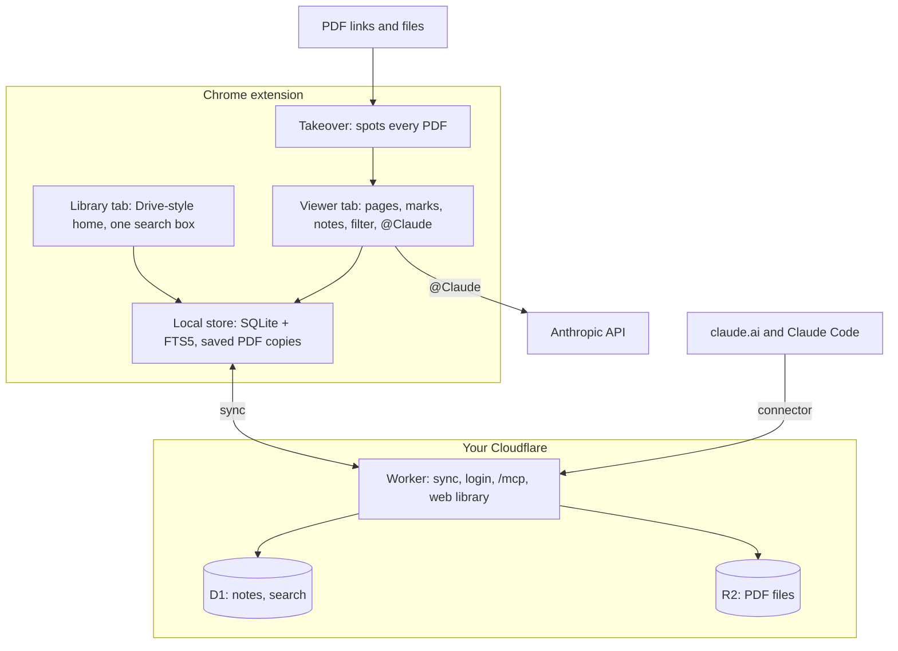
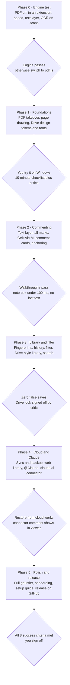

<!-- Canonical, commentable version: https://claude.ai/artifact/X5hCQYmpfh8QM5Zg4A9SEJ . This file is an export for build agents; keep it in sync with the doc. -->

# sickofpdfs — Design Spec v1

Oct 31, 2026 · @rex

## Summary

sickofpdfs is a Chrome extension that replaces Chrome's PDF viewer with a Google-Drive-style reader. You highlight and comment with Ctrl+Alt+M, ask Claude inside comment threads, and every learning PDF you read lands in a searchable library. The library syncs to your own Cloudflare account, so claude.ai can search it too. Commenting is the core feature; everything else supports it.

**v1 is done when all of these are true:**

1. Clicking any PDF link in Chrome, or double-clicking a PDF on your computer, opens it in our viewer in the same tab. The first page of a typical paper shows in under 1 second.
2. Select text, press Ctrl+Alt+M, type, press Enter: a highlight and note are saved. Highlight, underline, bold and strikethrough each take one keystroke or one click. The note box appears in under 100 ms, and no mouse is needed.
3. Reopening the same link, the same file from another folder, or a re-downloaded copy shows the same notes.
4. Learning PDFs are saved automatically. On the 44-PDF test set, zero receipts, invoices or statements are saved.
5. Typing @Claude in a thread returns a streamed answer with clickable page citations.
6. In claude.ai, the sickofpdfs connector can search your library and add a comment that then appears in the viewer.
7. The library and viewer clearly feel like Google Drive: same colours, type, icons and spacing, as judged by the visual critic.
8. Resetting Chrome or reinstalling the extension loses nothing: the library restores from your cloud.

## Requirements and decisions

Every request so far is mapped to one decision below. Anything not in this table is out of scope for v1.

| You asked for | Decision |
| --- | --- |
| Use it in Chrome, not a separate app | A Chrome extension only. It takes over every PDF automatically, in the same tab. |
| A default PDF reader, including links clicked online | Set Chrome as the Windows .pdf app once. The extension then takes over local files (file://) and web links. |
| Seamless commenting with Ctrl+Alt+M (the core feature) | Select text, press Ctrl+Alt+M, type, press Enter. Notes appear as Google-Docs-style cards in the right margin, with reply threads. Highlight, underline, bold and strikethrough are one keystroke each. |
| Integrated with Claude, like Claude Docs | Two parts: @Claude inside any comment thread (your API key), plus a claude.ai connector that can search your library and add comments. |
| Save PDFs and a history of what you read | Learning PDFs are copied into the library automatically, with reading history, resume position and one search over titles, full text and notes. |
| Only learning PDFs, never receipts | An on-device filter decides before anything is stored. Non-learning PDFs leave no trace. |
| Notes stay on the link and persist | Each PDF is identified by a fingerprint of its contents, and links and file paths are remembered as places it was seen. Notes survive moves, renames and new versions. |
| Hosted | Your own free Cloudflare account runs sync, backup, a web version of the library, and the Claude connector. |
| Looks like Google Drive (the look and feel) | Drive's Material 3 look and feel: its colours, type, icons, spacing and components. Close in feel, not a pixel-for-pixel copy. |
| Beat Foxit and Google's viewer | Chrome's own PDF engine (PDFium), plus the best ideas from pdf.js, Hypothesis, Zotero, Sioyek and Google Docs. |
| Build on existing repos, no hand-made assets | Reuse open-source code and official icon and font sets (see Licences and credits). |
| Orchestrated build with harsh critics | Build agents write the code. Independent critic agents and automated screenshot checks gate every phase (the gauntlet loop). |

**Not in v1:** phone apps, Firefox and Safari, ink drawing, flashcards, sharing with classmates, editing your original files in place, a Ctrl+Alt+M that works inside other apps such as Foxit, and a Chrome Web Store listing (you install it directly first).

## How it feels to use

Ten everyday moments, start to finish. Each one becomes an automated end-to-end test.

1. **You click any PDF link.** It could be a journal article, a Moodle reading, lecture slides or a textbook chapter. The tab shows our viewer, not Chrome's. A chip in the top bar reads "Saved to library" (reasons on hover, such as "References section, DOI, 40 pages"). If you have read it before, it opens where you stopped.
2. **You double-click a PDF in File Explorer.** Chrome opens it (it is your default PDF app) and the extension takes over. If that file was seen before, even in another folder or under another name, your notes appear.
3. **You open a scanned PDF.** A photographed chapter or an old journal scan has no real text. Text recognition runs on your computer, visible pages first, so within seconds you can select, mark up and comment exactly as on any other PDF, and its words become searchable.
4. **You mark up and comment.** Select text and a small toolbar appears beside it, as in Google Docs. Highlight (H), underline (Ctrl+U), bold (Ctrl+B), strikethrough (Alt+Shift+5) and comment (Ctrl+Alt+M) apply instantly, with no tool to pick first. For a comment, a note box opens in the right margin, level with the line. Type, then press Enter. Shift+Enter adds a new line, and Esc closes without losing text. With nothing selected, Ctrl+Alt+M makes a note for the page.
5. **You ask Claude.** In a note or reply, type "@Claude why does this assumption matter?" Claude's answer streams into the thread with page links such as "p. 4" that jump to the passage.
6. **You look something up next week.** Press Ctrl+K in any viewer or library tab and type "parallel trends". Results show readings, matching pages and your notes; Enter jumps to the exact passage.
7. **You ask claude.ai.** "What did I note about difference-in-differences this term?" The connector searches your library and Claude answers with sources. "Add a comment on page 3 summarising this" appears in the viewer as a comment from Claude.
8. **You move, rename or re-download a file.** Same contents, same fingerprint, same notes. The library records the new location.
9. **Your professor uploads a new version to the same link.** Notes re-attach by matching the quoted text. Any that cannot be placed are listed under "Couldn't place" with their quote, never deleted.
10. **You open a receipt.** It displays normally with the chip "Not saved: looks like a receipt". Nothing is stored, indexed or uploaded. If the filter is wrong, one click on the chip saves it.

## Architecture

Two halves: a Chrome extension that does all reading and works offline, and a small server on your Cloudflare account that keeps a synced copy for backup, the web library and Claude.



The viewer is the hub: it reads PDFs, writes to the local store, and calls Claude directly. Only the local store talks to the cloud.

| Piece | Runs in | Job |
| --- | --- | --- |
| Takeover | Extension background (service worker) | Spots PDFs on web pages and local files and sends the tab to our viewer. Logic adapted from Mozilla's pdf.js extension. |
| Viewer | Extension page, one per tab | Draws pages with PDFium, adds the invisible text layer, highlights, margin comment cards and @Claude. |
| Library | Extension page | Google-Drive-style home: Home, Library, Recent, Starred, Courses, Notes, Trash, and search. |
| Local store | Hidden offscreen page plus a worker | The only owner of the local database (SQLite with full-text search) and of saved PDF copies. All tabs talk to it. |
| Learning filter | Inside the viewer, in memory | Decides "learning or not" before anything is written anywhere. |
| Sync server | Cloudflare Worker | Login, sync API, PDF uploads, web library pages. |
| Cloud data | Cloudflare D1 + R2 | D1 holds notes, metadata and page text with search; R2 holds PDF files. |
| Claude connector | Same Worker, at /mcp | Lets claude.ai and Claude Code search, read and comment. |

**Repository layout (one repo, pnpm workspaces):**

```text
apps/extension     Chrome MV3 extension (WXT): background, viewer, library, offscreen store
apps/cloud         Cloudflare Worker: sync API, MCP connector, OAuth, web library
packages/ui        Google Drive design system: tokens, fonts, icons, components
packages/viewer    PdfBackend adapter, PDFium engine, text layer, annotation layer
packages/core      data model, fingerprints, anchoring, learning filter, sync protocol
docs/              this spec, research reports, reference screenshots
```

**Tech stack (versions verified on npm, 31 Oct 2026):**

| Area | Choice |
| --- | --- |
| Extension framework | WXT 0.21.5, Vite 8.3, React 19.3, TypeScript 7 |
| PDF engine | EmbedPDF @embedpdf/\* 2.15.1 (PDFium compiled to WebAssembly), pinned, small patches. Version 3 if Phase 0 shows it is better. |
| Takeover | Vendored from mozilla/pdf.js extensions/chromium |
| Anchoring | Vendored Hypothesis match-quote plus approx-string-match |
| Local database | @sqlite.org/sqlite-wasm 3.54.1 with FTS5, stored in the origin private file system |
| UI building blocks | Radix UI primitives, Material Symbols Outlined, Google Sans fonts bundled locally |
| Claude | @anthropic-ai/sdk 1.3.0; default model claude-opus-5-5, changeable in Settings |
| Filter tie-breaker | transformers.js with the MiniLM model (23 MB) bundled, no downloads at run time |
| Cloud | Cloudflare Workers, D1, R2, Workers Static Assets, Workers OAuth Provider, MCP server SDK |
| Tests | Vitest, Playwright driving Chromium with the extension loaded, pixelmatch for screenshot diffs |

## Viewer and commenting

Pages are drawn by PDFium, the engine inside Chrome's own viewer. On top of them sits an invisible text layer, so selecting, double-clicking and copying work like any web page.

**Engine.** All engine calls go through one `PdfBackend` adapter: open, render tiles, glyph geometry, search, annotations, export. Pages scroll in a virtual list (only visible pages exist), render in a worker, and re-render sharply at any zoom or screen scaling. pdf.js stays a drop-in fallback behind the same adapter. PDFium is Google's own engine, used by Chrome and Drive, and Chromium's PDF viewer code is open source (BSD licence): we reuse its zoom steps, fit modes, keyboard scrolling and toolbar behaviour where they fit.

**Text layer.** For each page we place transparent text spans at PDFium's exact glyph boxes. The browser's native selection then works: drag, double-click a word, triple-click a line, Shift+arrows, Ctrl+C, screen readers. Selections map back to PDFium character ranges, so highlights land on exact glyphs.

**Scanned PDFs.** When a page has no real text, text recognition (OCR) runs on your computer in a background worker, visible pages first, and the result is saved so it runs once per document. The recognised words become the same invisible text layer, so selecting, marking up and commenting work exactly as on a normal PDF, and the words are searchable. The baseline is tesseract.js; Phase 0 also tests a PaddleOCR model and keeps whichever is more accurate at acceptable speed. Chrome's own built-in text recognition is not available to extensions, so we bring our own.

**What a note is made of:**

- **Mark:** its style (highlight, underline, bold or strikethrough), colour, the page boxes it covers (one set per page, so it can span pages), and a text anchor: the exact quote, 32 characters before and after, and its character position.
- **Thread:** belongs to one mark, page point, page or document. It holds comments, each with author (you or Claude), Markdown body, created and edited times.
- **Re-anchoring on open:** exact position, then the quote on the same page, then a fuzzy match across the document (Hypothesis method). Anything still unplaced goes to "Couldn't place".

**Marking text.** Select text and a small toolbar appears beside the selection, as in Google Docs: highlight (with colour), underline, bold, strikethrough, comment, Ask Claude and copy. Every mark applies instantly from the toolbar or its shortcut; there is no tool to pick first. Applying the same style again removes it. A PDF cannot change its own font, so bold is drawn by thickening the letters' own pixels, and it exports with its own appearance so Foxit and Acrobat show it too. Any mark can carry a comment thread.

**The Ctrl+Alt+M flow:**

1. With text selected, Ctrl+Alt+M creates the highlight in under 50 ms. A note box opens in the right margin, level with the selection, never covering it.
2. Type in plain text or light Markdown, including maths written as `$x^2$`. The draft saves every 300 ms, so a crash loses nothing.
3. Enter or Ctrl+Enter saves. Shift+Enter adds a new line. Esc or clicking away keeps any typed text; an empty note removes its highlight.
4. No selection: a note on the page under the pointer, or the most visible page. Ctrl+Alt+Shift+M opens the single "my takeaways" note for the document.
5. A selection over an existing highlight opens that highlight's thread instead of stacking a duplicate.
6. Cards line up with their highlights down the margin, like Google Docs. The active card moves left and its highlight darkens.

**Colours with fixed meanings:** yellow = key point, blue = definition, green = evidence, pink = question, grey = to do. Keys 1 to 5 recolour; your last colour is remembered.

**Shortcuts.** Ctrl+Alt shortcuts never fire while you are typing, because on some keyboards Ctrl+Alt is AltGr. All are rebindable in Settings.

| Action | Keys |
| --- | --- |
| Comment on selection, or page note | Ctrl+Alt+M |
| Document note | Ctrl+Alt+Shift+M |
| Highlight, underline, bold, strikethrough (with a selection) | H, Ctrl+U, Ctrl+B, Alt+Shift+5 |
| Save note / new line / close | Enter or Ctrl+Enter / Shift+Enter / Esc |
| Next / previous note | Ctrl+Alt+N / Ctrl+Alt+P |
| Move between annotations | Tab / Shift+Tab |
| Recolour / delete focused highlight | 1 to 5 / Delete (with Undo) |
| Go anywhere: library, notes, commands | Ctrl+K |
| Find in document / go to page | Ctrl+F / Ctrl+G |
| Notes panel / thumbnails and outline | Shift+F4 / F4 |
| Save to library (override the filter) | Ctrl+Alt+S |
| Export notes as Markdown | Ctrl+Shift+E |
| Shortcut sheet | ? |

Jumps inside a document are pushed to browser history, so Chrome's own Back and Forward (Alt+Left and Alt+Right) return you to where you were.

**Export and import.** "Download with notes" writes a copy with standard PDF annotations: highlights, underlines, strikethroughs, bold marks, comments and reply threads that Foxit and Acrobat display. "Export notes" writes Markdown with quotes, page numbers and links back. Annotations already inside a PDF are imported on first open. Your original file is never modified.

**Speed budgets (tested on every build):** first page under 1 s for a 50-page paper. A 600-page scanned textbook scrolls without a blank page showing for more than 150 ms. Any mark under 50 ms, note box under 100 ms.

## Library and knowledge base

A PDF is known by what it contains, not where it lives. Links and file paths are only places it has been seen, so moving, renaming or re-downloading never loses notes.

**Identity, in the order we check:**

1. **Exact file:** SHA-256 of the bytes, computed while the file streams in. Same bytes from any link or folder = same document.
2. **Same link:** the canonical URL. Tracking parameters are stripped; arXiv abs, pdf and vN links collapse to one arXiv id; DOI links collapse to the DOI.
3. **Same work, new version:** the PDF's permanent ID (/ID first half), arXiv id, DOI, or near-identical text on the first pages. Versions group into one "work" and notes re-anchor onto the newest version.
4. Otherwise it is a new document.

Each document keeps its list of locations (links and file paths, with first and last seen). Saved learning PDFs are also copied into the library, so a dead link or deleted file still opens.

**What the history records per reading:** title, authors, year, DOI or arXiv id, locations, first and last opened, total reading time, last position (opening resumes there), pages visited, note count, starred, course. Metadata comes from the PDF itself, its first page and its ids. Optional online lookups (arXiv, Crossref) send only the id.

**One search box (Ctrl+K)** covers titles, authors, full page text, your notes and Claude's replies, ranked by relevance with highlighted snippets. Enter jumps to the exact page and passage. Filters: type (paper, textbook, slides, notes), course, starred, has notes, date read.

**Library pages, laid out like Google Drive:**

| Page | Shows |
| --- | --- |
| Home | Continue reading, recent notes, suggested readings from your current courses |
| My library | Every saved reading, list or grid view, sortable like Drive |
| Recent | Readings by last opened |
| Starred | Readings you starred |
| Courses | Automatic groups by module code (such as EC1A1), Moodle course or source |
| Notes | Every note and thread across all readings, newest first, searchable |
| Trash | Removed readings and notes, kept 30 days |

The "+ New" button offers Upload PDF, Open file, and Paste link.

## Learning filter and privacy

The filter runs on your computer, in memory, before anything is stored. On 44 public test PDFs it made 43 correct decisions, 1 "ask me", and saved zero receipts or statements.

**Steps (stop at the first that decides):**

1. **Your rules:** a per-file choice, then deny lists, then allow lists for sites and folders (for example, always save from moodle.lse.ac.uk).
2. **Score** from cheap signals in under 150 ms: the link, file name, PDF metadata, page count and shape, and text from the first and last 5 pages (for a scan, recognised by OCR in memory only).
3. **Hard rules:** a valid card number, IBAN, sort code with account number, National Insurance number, passport line or boarding-pass code blocks saving. An arXiv id plus a References section forces saving.
4. **Decide:** score of 3 or more saves; 0 or less does not; anything between is "not sure".
5. **Not sure:** a small local model (MiniLM, about 20 ms) nudges the score. If still unsure, you are asked.

The score starts at −1, so an unknown PDF needs evidence before it is saved.

| Signal | Weight |
| --- | --- |
| arXiv id in text or file name | +4 (file name +3) |
| Scholarly site (arXiv, JSTOR, SSRN, NBER, Springer, ScienceDirect, OpenStax, about 40 more) | +3 |
| References or Bibliography heading | +2.5 |
| Long document: 100+ / 30+ / 8+ pages; 2 or fewer pages | +2.5 / +2 / +1; −1 |
| Abstract heading, DOI, thesis wording | +2 each |
| Moodle, Canvas, reading lists, lecture capture | +2 |
| Many citations (20+ / 5+) | +2.5 / +1.5 |
| Academic vocabulary, maths symbols | up to +2, up to +1.5 |
| Chapter, Lecture, Week or Contents; ISBN; LaTeX-made PDF | +1.5 each |
| University domain (.ac.uk, .edu), slide-deck shape, course words in path | +1 each |
| Each admin term group (invoice, VAT, sort code, payslip, boarding pass…) | −1, up to −5 |
| Lots of currency amounts | up to −3 |
| Bank, shop, airline, tax or e-signature site | −4 |
| Receipt-roll page shape, tax-form type, invoice/receipt in path | −2 each |
| Made by invoice-generator software | −1 |

> **Privacy rule.** Until a PDF is classified as learning it leaves no trace: no history row, thumbnail, search entry, log line or upload. Its text is dropped when the tab closes. Nothing about any PDF is sent anywhere unless it is saved to your library.

**When the filter is wrong:**

- The chip in the top bar always shows the decision; click it, or press Ctrl+Alt+S, to save. Saving back-fills the history and keeps any notes already made.
- "Not sure" PDFs show a quiet banner after 20 seconds, or straight away when you add your first note: Save, Not now, Never for this file, or Always for this site.
- "Forget this PDF" in the chip's menu removes it completely, with an option to never save it again.
- Notes on an unsaved PDF are kept in memory, and closing the tab asks whether to save them.
- Settings has the allow and deny lists, pre-filled with suggestions such as moodle.lse.ac.uk.

The 44-PDF test set runs on every build. Any receipt, invoice or statement saved fails the build.

## Storage, sync and backup

Everything is written locally first, so reading and noting work offline. A copy then syncs to your cloud, which is also the backup.

**On your computer (inside Chrome):**

- **Database:** SQLite with full-text search, owned by one hidden background page, so tabs never fight over it. Tables: documents, locations, page text, annotations, threads, comments, reading history, settings, and an outbox of changes waiting to sync.
- **PDF copies:** stored as files named by their fingerprint, in Chrome's private file storage for the extension. Duplicates are stored once.
- **Safety:** the extension asks for unlimited storage, and the manifest has a fixed key, so its identity (and data) survive updates and folder moves.

**Sync rules:**

- Every record has a random id, an updated time, and a deleted flag (deletes are kept as markers so they sync too).
- Changes queue in the outbox and upload in batches whenever you are online. Other devices, the web library and Claude's comments come back down through "give me everything since my last sync".
- If the same record changed in two places, the newer change wins. Typed text is never thrown away: the other version is added to the thread as a reply marked "edited on another device".
- PDFs upload once per fingerprint, in chunks, from an open library or viewer tab (Chrome stops background work after 30 seconds). Page text uploads too, so the connector can search it.
- A toggle in Settings can keep PDF files local and sync only notes and text.

**Backup and restore:** your cloud copy is the backup. On a new computer, or after reinstalling, sign in once and the library downloads. "Export library" also saves a zip with every PDF, notes as Markdown, and the data as JSON.

**Warning shown during setup:** removing the extension deletes its local data. Anything not yet synced would be lost, so the library shows the last sync time and an alert if sync has been stuck for more than a day.

## Claude integration

Claude works in two places: inside comment threads while you read, and in claude.ai through a connector that can see your whole library.

**1. @Claude in comment threads**

- Type @Claude anywhere in a note or reply. Claude receives the document's text page by page, the highlighted quote, and the thread so far.
- The answer streams into the thread as a comment from Claude. Page citations such as "p. 4" are links that jump to the passage.
- The document text is cached for an hour, so follow-up questions are cheap. A 30-page paper costs about $0.10 for the first question and about 1 cent per follow-up on the default model.
- Default model: Claude Opus 5.5. Settings lets you switch to Sonnet 5.5 or Haiku 5.5 to spend less.
- Your API key is stored only in the extension's private storage, which web pages cannot read. Calls go straight from the viewer tab to Anthropic. Setup suggests a monthly spend limit on the key.

**2. The claude.ai connector**

The Worker on your Cloudflare account serves a connector at /mcp. You add it once in claude.ai under Connectors, and sign in. It works in claude.ai on the web, desktop and phone, and in Claude Code.

| Tool Claude can use | What it does |
| --- | --- |
| search\_library | Search titles, full text and notes; returns readings, passages and note snippets |
| list\_recent | What you read recently, with dates and note counts |
| get\_document | A reading's details and the text of chosen pages |
| get\_notes | Highlights, notes and threads, for one reading or all |
| add\_comment | Add a Claude comment on a quote, page or reading; it appears in your viewer after sync |
| reply\_to\_thread | Reply inside one of your existing threads |

Only you can sign in to the connector. Claude's comments are always labelled as Claude's, and you can delete them like any other.

## Hosting

One Cloudflare Worker on your free account serves everything: the sync API, the Claude connector, login, and the web library. It never opens a PDF itself; all PDF work happens in Chrome.

| Part | Choice |
| --- | --- |
| Address | `https://sickofpdfs.<your-subdomain>.workers.dev`. Free. Chosen once, because the Claude connector and the extension are tied to it. |
| Worker routes | `/api/*` sync and uploads, `/mcp` Claude connector, `/oauth/*` login, everything else the web library |
| Database | D1 `sop_meta` for documents, notes and sync state; D1 `sop_text_0`, `sop_text_1`… for page text with full-text search (split because each free database holds 500 MB) |
| PDF files | R2 bucket `sop-blobs`, one file per fingerprint; large files upload in 32 MB parts through the Worker |
| Login | GitHub sign-in, locked to your GitHub account's numeric id; any other account gets refused |
| Connector | MCP over Streamable HTTP (`agents` 0.32 `createMcpHandler`, `@modelcontextprotocol/server` 2.4), OAuth by `@cloudflare/workers-oauth-provider` 1.2.4 with Claude's published client identity |
| Extension sign-in | The same GitHub login in a Chrome pop-up; the token stays in the extension's private storage |
| Web library | The same React library and viewer, served as static files by the Worker |
| Deploys | GitHub Actions on every push to main: database migrations, then `wrangler deploy` |

**Sync details.** Each record carries a revision, a timestamp and a deleted marker, with one global cursor per device. If the same note is edited on two devices, the newer edit wins and the other version is added to the thread as a reply marked "edited on another device". Claude's connector writes count as one more device.

**What Claude may do through the connector:** read and search your library, and add or edit its own comments. It cannot delete your notes, edit your words, or download PDF files. In claude.ai you can set the write tools to "ask first".

**What goes to the cloud:** only PDFs the filter (or you) marked as learning; the server also refuses anything else. Links are cleaned of tokens, and local file paths are reduced to file names. PDF upload is on by default, with a global switch and a per-document "keep local" option.

**Cost for about 2,000 PDFs (about 10 GB):** free, with three tight spots.

| Free limit | Effect | If exceeded |
| --- | --- | --- |
| R2 storage 10 GB | Roughly the size of the library | $0.015 per GB per month (15 GB is about $0.08) |
| D1 100,000 rows written per day | The first full-text indexing of a big library takes 5 to 8 days | Indexing just runs slower; no data is lost |
| Worker 10 ms CPU per request | Connector calls measured 2 to 3 ms | Workers Paid ($5 a month) lifts all three limits |

Turning on R2 needs a one-time checkout in the Cloudflare dashboard, which may ask for a card even though usage stays free.

## Visual design

The library takes Google Drive's Material 3 look and feel, and the viewer takes the feel of Drive's new PDF viewer (December 2025) with Google Docs comment cards added. The goal is the same aesthetic, not a pixel-for-pixel copy; the measured values are the starting point.

**Source of truth.** The research report holds every measured value, 37 reference screenshots and Drive's own colour tokens copied from its production CSS. Each value is labelled live-measured, Google CSS, or estimated from official images (±2 px).

**Colours (Drive's GM3 palette):**

| Role | Value |
| --- | --- |
| Primary (buttons, links, focus ring) | #0b57d0 |
| App background and top bar | #f8fafd |
| Content card | #ffffff, 16 px corners |
| Search bar | #e9eef6 |
| Menus and grid cards | #f0f4f9 |
| Selected nav item and selected row | #c2e7ff, text #004a77 (nav #001d35) |
| Row hover | #ededed |
| Text / secondary text | #1f1f1f / #444746 |
| Dividers / outlines | #c4c7c5 / #747775 |
| Viewer canvas / toolbar pill | #1b1b1b / #333537 |
| PDF file icon | #fc413d |

**Type and icons.** Google Sans for titles, Google Sans Text (Google Sans at optical size 17) for body text and rows, Google Sans Flex for menus and buttons. All three are open-licensed (OFL) and bundled inside the extension, so nothing loads from the internet. Icons are Material Symbols Outlined at weight 400, unfilled, filled when selected. The PDF file icon comes from Material Design Icons (file-pdf-box). Google's logo, Product Sans and Drive's own file icons are not used; our mark sits in the logo slot.

**Screens and their Drive reference:**

| Our screen | Matches | Key measurements |
| --- | --- | --- |
| Library shell | Drive, My Drive | Top bar 64 px; search 48 px tall, round ends; nav 256 px wide with 32 px pill items; "+ New" 56 px tall, 16 px corners |
| Reading list | Drive list view | Rows 48 px with 1 px divider; hover, selected and keyboard-focus states exactly as Drive |
| Grid | Drive grid view | 220 × 220 cards, 12 px corners, first-page thumbnail |
| Home | Drive Home | "Welcome" title, collapsible Continue reading and Recent notes sections |
| Menus and tooltips | Drive menus | Menu items 32 px, 4 px corners; dark tooltip #303030 |
| Viewer | Drive PDF viewer | 64 px header with file name and File, View, Tools, Help menus; 48 px pill toolbar; thumbnail and outline rail; white pages with 16 px gaps |
| Comment cards | Docs margin cards | 282 px wide, 12 px corners, 10 px apart; active card turns white, lifts, and shifts 12 px left |
| Notes panel | Docs comments sidebar | 320 px wide, 16 px corners, All and Mine tabs, thread cards with reply box |

Our additions (Comment, colour, Ask Claude, the library status chip) reuse Drive's own button and chip styles, such as the signed-in viewer's "Comment" text button. The library also follows Windows dark mode using Drive's dark tokens.

**Design rules the critics enforce:**

- Colours, fonts, icons and spacing come only from the shared token file, taken from Drive. A lint rule blocks raw values.
- Components follow Drive's patterns: pill navigation, rounded search, 48 px rows, menus, chips, tooltips.
- The visual critic compares our screens with the Drive references side by side and flags anything that looks off-brand or inconsistent. Close in feel is the bar; exact pixels are not required.

## Quality process: the gauntlet loop

No piece of work counts as done until it survives the gauntlet. Builders never grade their own work.

1. **Build.** A build agent writes the tests first, then the code, on its own branch.
2. **Automated gates**, all green: type check, lint (including the design-token rule), unit tests, end-to-end tests in Chromium with the extension loaded, the 44-PDF filter test, speed budgets, and screenshot checks that catch unintended visual changes.
3. **Critics.** Four critic agents start fresh. They get the spec, the running build and screenshots, but never the builder's reasoning. Every defect must come with evidence and a rating: critical, major or minor.
4. **Fix and repeat.** The builder fixes; every gate and critic runs again.
5. **Pass** = zero critical, zero major, all automated gates green. After three failed rounds the task is re-planned (split smaller or approached differently), not forced through.

| Critic | Checks | Evidence it must give |
| --- | --- | --- |
| Visual | Drive look and feel: colours, fonts, icons, spacing, hover, selected, focus, dark mode | Side-by-side screenshots against the Drive references |
| Experience | Every walkthrough in "How it feels to use", keyboard only; speed budgets; no lost text; AltGr safety | Timed step logs and recordings |
| Code and security | Correctness, data-loss paths, the privacy rule, API key handling, Chrome's no-remote-code rule, licences | File and line for each finding |
| Student | "Would I switch from Foxit and Chrome's viewer?" using real readings end to end | Ranked list of frictions |

**At the end of each phase** you get a short demo (screenshots and a screen recording) and the list of what passed.

**On your PC:** a few things only run on Windows, such as double-clicking a PDF in File Explorer. After Phase 1 you get a 10-minute checklist to try them.

## Build phases

Six phases, each closed by a gauntlet gate and a short demo for you. Phase 0 starts as soon as you approve this spec.



Phase 0 is the throwaway engine test: it checks that PDFium runs inside a Chrome extension, scrolls a 600-page scan within budget, that the invisible text layer lines up, and how fast and accurate text recognition is on scanned pages. Phases 1 to 5 follow the implementation plan written after this spec is approved.

## Risks

The two engine risks are tested first, in Phase 0, before anything is built on top of the engine.

| Risk | Effect if it happens | How it is handled |
| --- | --- | --- |
| Chrome blocks the PDFium engine's helper workers inside the extension | Viewer cannot render | Phase 0 tests it on day one. Fixes: a patched worker URL, EmbedPDF version 3 (built for this), or pdf.js behind the same adapter |
| Slow scrolling on huge scanned textbooks | Reading feels laggy | Phase 0 measures a 600-page scan against the 150 ms budget; tiling and lower-resolution previews first; pdf.js fallback |
| EmbedPDF is mid-rewrite (v2 to v3) | Upgrades break things | Exact version pins, all calls through the adapter, upgrade only after the gauntlet passes |
| Removing the extension deletes local data | Unsynced notes lost | Cloud sync is the backup; fixed extension key; last-sync time and stuck-sync alert in the library |
| The double-click chain on Windows is untested | Local PDFs open in Chrome's viewer | Your 10-minute checklist after Phase 1; the library's "Open file" button works regardless |
| Some PDFs cannot be re-fetched (form posts, expiring links, some logins) | Viewer shows an error | Fall back to Chrome's viewer with an "Import this PDF" button |
| Filter mistakes on new kinds of PDF | A reading not saved, or a private PDF saved | Asymmetric thresholds, "ask" path, one-click fixes, and the test set grows with every reported mistake |
| Ctrl+Alt+M clashes with AltGr keyboards | Typing µ triggers a note | Never fires inside text fields; rebindable |
| API key in the browser | Key misuse if the PC is compromised | Extension-private storage only, spend limit, delete key in one click |
| Cloudflare free tier exceeded | Small monthly cost | PDF upload toggle; usage shown in Settings (see Hosting) |
| Text recognition is slow or inaccurate on poor scans | Some words hard to select or find | Visible pages first, results cached; Phase 0 picks the more accurate engine; area notes always work |

## One-time setup for you

About 45 minutes, once, with no developer tools on your PC: GitHub Actions does the server deploy for you. A step-by-step guide with screenshots ships in the repo as SETUP.md.

**Chrome (10 minutes)**

- [ ] Download the latest release zip from the repo's Releases page and unzip it to a folder you will keep, such as Documents\\sickofpdfs.
- [ ] Open chrome://extensions, switch on Developer mode, click Load unpacked, and choose that folder. Pin the extension.
- [ ] On the extension's Details page, switch on "Allow access to file URLs". Chrome reloads the extension once.
- [ ] Windows Settings → Apps → Default apps → type .pdf → choose Google Chrome.

**Cloudflare (15 minutes)**

- [ ] Create a free account and pick your workers.dev subdomain (it becomes part of your library's address).
- [ ] Turn on R2 (Storage → R2), completing the free checkout.
- [ ] Create an API token with the permissions listed in SETUP.md, and copy your Account ID.

**GitHub (10 minutes)**

- [ ] Create a GitHub OAuth App using the callback address SETUP.md gives you.
- [ ] In rexheng/sickofpdfs → Settings → Secrets → Actions, add CLOUDFLARE\_API\_TOKEN, CLOUDFLARE\_ACCOUNT\_ID, GITHUB\_CLIENT\_ID and GITHUB\_CLIENT\_SECRET. The first deploy then runs by itself.

**Connect everything (10 minutes)**

- [ ] Extension → Settings → Cloud → Connect, and sign in with GitHub.
- [ ] For @Claude: create an API key at console.anthropic.com with a monthly spend limit, and paste it into the extension's Settings.
- [ ] In claude.ai: Settings → Connectors → Add custom connector. Name it "My readings", use the address ending in /mcp, choose "Use Claude's published identity", and sign in with GitHub.

## Licences and credits

Everything reused is under a permissive licence, so the app can be shared later. AGPL projects are studied for ideas only; none of their code is copied.

| Project | Licence | How we use it |
| --- | --- | --- |
| [EmbedPDF](https://github.com/embedpdf/embed-pdf-viewer) (PDFium) | MIT (npm) / Apache-2.0 | Dependency, pinned, small patches; comment sidebar ported to React |
| [pdf.js](https://github.com/mozilla/pdf.js) Chrome extension | Apache-2.0 | PDF takeover logic copied and adapted; fallback engine |
| [Hypothesis client](https://github.com/hypothesis/client) anchoring | BSD-2-Clause | Quote matching copied |
| approx-string-match | MIT | Dependency (fuzzy matching) |
| [SQLite WASM](https://sqlite.org/wasm) | Public domain | Local database and search |
| WXT, React, Radix UI, Vite | MIT | Dependencies |
| transformers.js, MiniLM model | Apache-2.0 | Filter tie-breaker |
| Material Symbols | Apache-2.0 | All icons |
| Material Design Icons (file-pdf-box) | Apache-2.0 | PDF file icon |
| Google Sans, Google Sans Flex | SIL OFL 1.1 | Bundled fonts |
| Anthropic TypeScript SDK | MIT | @Claude calls |
| Cloudflare Workers OAuth Provider, MCP SDK | MIT / Apache-2.0 | Hosting and connector |
| Zotero reader, Readest, Koodo Reader | AGPL-3.0 | Ideas only, no code |

Not shipped: Google's logos, Product Sans, Google Symbols and Drive's own file icons, which are Google brand assets. The name "EmbedPDF" is a trademark and is not used for this app.
